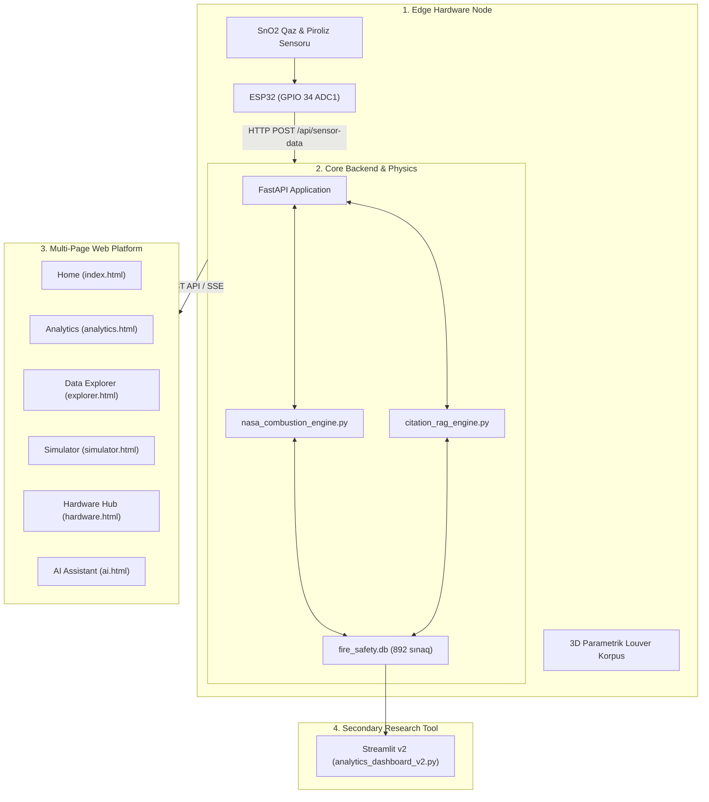

# FIRE-X: DEFINITIVE FULL-SCALE MASTER MVP SPECIFICATION
## NASA International Space Apps Challenge 2026 — "Flame in Freefall"
**Layihə Adı:** FIRE-X (Microgravity Combustion Intelligence Platform & Atmospheric Boundary Telemetry Node)  
**Komanda:** SpaceAz (Murad Fatullazada, Sabir Məmmədzadə, Raiz Həkimov, Şahvələd Vəlizadə, Hüseyn Alırzayev)  
**Təyinat:** İstənilən AI Coding Agent (Claude 3.7 Sonnet, OpenAI Codex, Google Antigravity) və Baş Sistem Arxitektorları üçün sıfırdan sona qədər heç bir sual vermədən, tam qeyri-müəyyənliksiz (Zero-Ambiguity) tətbiq və istehsalat sənədi.  
**Versiya:** 4.0.0 Definitive Enterprise Master Blueprint

---

## MÜNDƏRİCAT
1. [NASA Space Apps Challenge 2026: "Flame in Freefall" Haqqında Tam Məlumat](#1-nasa-space-apps-challenge-2026-flame-in-freefall-haqqında-tam-məlumat)
2. [FIRE-X Layihəsi Haqqında Tam və Hərtərəfli Məlumat](#2-fire-x-layihəsi-haqqında-tam-və-hərtərəfli-məlumat)
3. [Vizual Aktivlər (Assets), Arxa Fon Şəkilləri və Qrafik Qaydaları (Hər Səhifə Üzrə Dəqiq)](#3-vizual-aktivlər-assets-arxa-fon-şəkilləri-və-qrafik-qaydaları)
4. [3D WebGL Alov Hissəcikləri və CAD Modellərinin Texniki Spesifikasiyası](#4-3d-webgl-alov-hissəcikləri-və-cad-modellərinin-texniki-spesifikasiyası)
5. [Ümumi Sistem Arxitekturası və 4 İnteqrasiya Səviyyəsi](#5-ümumi-sistem-arxitekturası-və-4-inteqrasiya-səviyyəsi)
6. [Fiziki Donanım (Hardware), ESP-32, SnO₂ Sensoru və Elektrik Sxemləri](#6-fiziki-donanım-hardware-esp-32-sno₂-sensoru-və-elektrik-sxemləri)
7. [Riyazi Mikroyerçəkim Yanma Fizikası Mühərriki (`nasa_combustion_engine.py`)](#7-riyazi-mikroyerçəkim-yanma-fizikası-mühərriki)
8. [NASA PSI Məlumat Boru Kəməri və SQLite Sxemi (892 Sınaq)](#8-nasa-psi-məlumat-boru-kəməri-və-sqlite-sxemi-892-sınaq)
9. [Sitat-Təsdiqli Təhlükəsizlik RAG AI Mühərriki (`citation_rag_engine.py`)](#9-sitat-təsdiqli-təhlükəsizlik-rag-ai-mühərriki)
10. [Bütün Səhifələrin, Komponentlərin və İstifadəçi Axınlarının Tam Spesifikasiyası](#10-bütün-səhifələrin-komponentlərin-və-istifadəçi-axınlarının-tam-spesifikasiyası)
11. [REST API və Telemetriya Endpointlərinin Tam Spesifikasiyası](#11-rest-api-və-telemetriya-endpointlərinin-tam-spesifikasiyası)
12. [Streamlit v2 İkincili Elmi Analitika Paneli](#12-streamlit-v2-ikincili-elmi-analitika-paneli)
13. [Münsif Meyarları və Qəbul Testləri (Acceptance Criteria)](#13-münsif-meyarları-və-qəbul-testləri)
14. [AI Agent üçün Addım-Addım İcra Runbook-u](#14-ai-agent-üçün-addım-addım-icra-runbook-u)

---

## 1. NASA SPACE APPS CHALLENGE 2026: "FLAME IN FREEFALL" HAQQINDA TAM MƏLUMAT

### 1.1. Çağırışın Rəsmi Kimliyi və Təşkilatçı Strukturlar
- **Beynəlxalq Hakaton:** NASA International Space Apps Challenge 2026.
- **Rəsmi Çağırış Adı:** *"Flame in Freefall"* (Sərbəst Düşmədə Alov).
- **Məsul NASA Missiya İdarələri:**
  1. *NASA Space Operations Mission Directorate (SOMD)* — Beynəlxalq Kosmik Stansiya (ISS) və aşağı Yer orbiti əməliyyatları.
  2. *NASA Biological and Physical Sciences (BPS) Division* — Mikroyerçəkimdə fiziki və kimyəvi qanunauyğunluqların tədqiqi.
  3. *NASA Glenn Research Center (GRC - Cleveland, Ohio)* — Yanma fizikası, CIR (Combustion Integrated Rack) və mikroyerçəkim düşmə qüllələrinin əsas elmi mərkəzi.
  4. *NASA Marshall Space Flight Center (MSFC - Huntsville, Alabama)* — PSI (Physical Sciences Informatics) məlumat bazasının rəqəmsal kuratoru.

### 1.2. Çağırışın Əsas Problemi və Məqsədi (Problem Statement)
Kosmik uçuşlar tarixində yanğın hər zaman astronavtlar üçün ən dəhşətli təhlükə hesab olunub (məsələn, 1997-ci ildə "Mir" kosmik stansiyasında $O_2$ generatorunun alışması nəticəsində baş vermiş fəlakətli yanğın). İnsanlı kosmik kəşfiyyat proqramları (BKS, NASA Artemis Ay Proqramı, Gateway stansiyası və Marsa pilotlu uçuşlar) genişləndikcə, kosmik gəmilərdə yanğın təhlükəsizliyi həyati kritik əhəmiyyət daşıyır.

Lakin Yerdə tətbiq olunan bütün klassik yanğın təhlükəsizliyi qaydaları, tüstü detektorları və söndürmə protokolları mikroyerçəkimdə **TAMAMİLƏ İFLAS EDİR**. 

**NASA-nın "Flame in Freefall" çağırışında iştirakçılardan tələb etdiyi əsas məsələlər:**
1. **Mikroyerçəkim Yanma Datalarının Təhlili:** NASA-nın 20 ildən artıq müddətdə BKS-də, düşmə qüllələrində (Drop Towers) və pilotsuz karqo gəmilərində (Cygnus) keçirdiyi real uçuş eksperimentlərinin (PSI bazası) telemetriya məlumatlarını emal etmək;
2. **Alovun Davranışının Modelləşdirilməsi:** Qravitasiyasız mühitdə alovun necə yayıldığını, materialların hansı hava axınlarında alovlandığını, damcıların necə boğulduğunu və radiativ sönmə hədlərini riyazi/süni intellekt alətləri ilə proqnozlaşdırmaq;
3. **Yeni Nəsil Təhlükəsizlik və Qərar Dəstək Həlli:** Gələcək kosmik missiyalar (xüsusilə oksigenlə zənginləşdirilmiş 34% $O_2$ Artemis Ay yaşayış modulları) üçün erkən xəbərdarlıq, yanğın təhlükə indeksi və qərar dəstək platforması formalaşdırmaq.

### 1.3. Mikroyerçəkimdə Yanma Niyə Yerdəkindən Tam Fərqlidir? (Fundamental Fizika)
NASA-nın bu çağırışda vurğuladığı təməl elmi prinsiplər:
- **Təbii İstilik Konveksiyasının (Buoyancy) İtməsi:** Yerdə qravitasiya ($1.0g$) isti, az sıx qazları yuxarı qaldırır, alova aşağıdan oksigen sorur və alov şam formalı (konusvari) olur. Mikroyerçəkimdə ($10^{-4}-10^{-6}g$) arximed qüvvəsi sıfıra enir. İsti qazlar yuxarı qalxmır!
- **Kürəvi Simmetriya (Spherical Flames):** Konveksiya olmadığı üçün alov yanacaq damcısının və ya mənbəyin ətrafında mükəmməl kürə forması alır. Oksigen yalnız molekulyar diffuziya (Stefan axını) ilə çox ləng şəkildə daxil olur.
- **Radiativ Sönmə (Radiative Extinction):** Yanma məhsulları ($CO_2$, su buxarı) və his hissəcikləri alovun ətrafında qalaraq onu boğur. Güclü istilik şüalanması baş verir və alov vaxtından əvvəl qəfil sönür (kritik sönmə diametri $d_e$).
- **Görünməz Soyuq Alovlar (Cool Flames, 600–800 K):** BKS-də FLEX sınaqlarında kəşf edildi ki, alkan damcılarında görünən isti alov söndükdən sonra belə, yanma 600–800 K temperaturda gözəgörünməz peroksi-radikal reaksiyası ilə davam edir. İnsan gözü və standart sensorlar onu görmür, lakin kabinəyə təsadüfən oksigen daxil olduqda qəfil partlayışla yenidən alışır!
- **Aşağı Axın Yanarlıq Piki (Low-Flow Flammability Peak - Ən böyük kosmik paradoks):** Durğun $0g$ havasında materiallar öz tüstüsündə boğulub sönsə də, ventilyasiya fanları işə düşüb zəif hava axını ($2 - 12\text{ sm/s}$) yaratdıqda, axın alova oksigen gətirir, lakin alovu söndürəcək qədər güclü olmur. Nəticədə alov **Yerdəkindən daha sürətlə və aqressiv yayılır!**
- **Tüstü Zəncirlənməsi və Reqolit Tozu Paradoksu:** Mikroyerçəkimdə tüstü hissəcikləri aqreqasiyaya uğrayaraq uzun fraktal zəncirlər yaradır. Bundan əlavə, Ay və Marsda astronavtların gətirdiyi iti mineral reqolit tozu ($>1\,\mu\text{m}$) Yerdəki standart optik sensorları aldadaraq davamlı yalançı siqnalizasiya (false alarm) verir.

---

## 2. FIRE-X LAYİHƏSİ HAQQINDA TAM VƏ HƏRTƏRƏFLİ MƏLUMAT

### 2.1. Layihənin Konsepti və İnnovativ Həlli
**FIRE-X**, NASA Space Apps 2026 üçün hazırlanmış, kosmik yaşayış modullarında mikroyerçəkim yanma dinamikasını proqnozlaşdıran, fiziki sensor telemetriyasını rəsmi NASA PSI uçuş eksperimentləri ilə birləşdirən qabaqcıl kiber-fiziki analitika ekosistemidir.

Layihə 4 əsas sütun üzərində qurulub:
1. **Fiziki Mühit Testbed Node (Atmospheric Boundary Telemetry Node - TRL-4):** ESP-32 mikrokontrolleri və $SnO_2$ elektrokimyəvi sensoru ilə təchiz olunmuş, kosmik modulun lokal küncündəki ilkin termal deqradasiya və piroliz qazlarını ölçən fiziki cihaz.
2. **Riyazi Mikroyerçəkim Yanma Mühərriki (`nasa_combustion_engine.py`):** Damcı sönmə diametri ($d_e$), məcburi axında alov yayılma sürəti ($S_f$), dinamik yanarlıq həddi ($MOC$) və Yanğın Təhlükə İndeksini ($FHI: 0.0 - 10.0$) hesablayan analitik riyazi modul.
3. **Sitat-Təsdiqli Təhlükəsizlik RAG Mühərriki (`citation_rag_engine.py`):** Kosmik uçuş təhlükəsizliyi standartı (NASA-STD-3001) çərçivəsində hallüsinasiyanı proqram səviyyəsində qadağan edən, hər bir tövsiyəni NASA-nın 892 rəsmi uçuş sınağına zəncirləyən qərar dəstək mühərriki.
4. **İkili İnterfeys Ekosistemi:**
   - *Əsas Veb Platforma:* FastAPI + Dark Space UI + Three.js 3D WebGL alov hissəcikləri və STL turntable nümayişi + Chart.js elmi qrafikləri.
   - *İkincili Tədqiqat Paneli:* Streamlit v2 + Plotly 3D interaktiv scatter və sınaq traektoriyaları.

### 2.2. Komanda Haqqında Məlumat (Team SpaceAz)
- **Komanda:** SpaceAz (Azərbaycan / Gəncə, Bakı, Sumqayıt, Qusar, Şəmkir)
- **Üzvlər və Rollar:**
  1. *Murad Fatullazada* — Hardware Lead, ESP32 daxili proqramlaşdırma və 3D CAD mexaniki mühəndislik.
  2. *Sabir Məmmədzadə* — Principal Backend Architect, FastAPI marşrutlaşdırma və paylanmış server arxitekturası.
  3. *Raiz Həkimov* — Lead Frontend & Creative Director, Three.js 3D WebGL, Dark Space Design System və interaktiv UI/UX.
  4. *Şahvələd Vəlizadə* — Cybersecurity & Safety Architect, Citation-Locked RAG qoruyucu filtrləri və NASA-STD-3001 uyğunluğu.
  5. *Hüseyn Alırzayev* — Data Scientist, NASA PSI verilənlər bazası kurasiyası, Fernandez-Pello modelləşdirməsi və riyazi mühərrik.

---

## 3. VİZUAL AKTİVLƏR (ASSETS), ARXA FON ŞƏKİLLƏRİ VƏ QRAFİK QAYDALARI

Hər bir səhifənin, kartın və modal pəncərənin arxa fonunda hansı şəkilin olacağı, hansı filtrlərin tətbiq ediləcəyi və dəqiq CSS parametrləri aşağıda qeyd olunub:

### 3.1. Rəsmi Qrafik Faylların İnventarı (`images/` qovluğu)

| Fayl Adı | Mütləq Fayl Yolu | Ölçü / Format | Vizual Təsviri | Harada İstifadə Olunur? |
| :--- | :--- | :--- | :--- | :--- |
| **`hero_bg.jpg`** | `/images/hero_bg.jpg` | $1920 \times 1080$, JPEG | BKS-in Yer orbitindəki möhtəşəm görünüşü, atmosferin mavi parıltısı və ulduzlu dərin kosmos. | **Landing Page (`/`) Hero Bölməsinin Arxa Fonu**. |
| **`analytics_bg.jpg`** | `/images/analytics_bg.jpg` | $1920 \times 600$, JPEG | Kosmik stansiya daxili telemetriya ekranları, kiber-qrafiklər və mavi kosmik parıltı. | **Analytics Hub (`/analytics`) Üst Başlıq Arxa Fonu**. |
| **`blueprint_schematic.jpg`** | `/images/blueprint_schematic.jpg` | $1440 \times 900$, JPEG | Kiber-mavi mühəndislik çertyoju, ESP32 mikrosxem xətləri və texniki cizgilər. | **Hardware Səhifəsi (`/hardware`) Sxem Bölməsinin Arxa Fonu**. |
| **`spacecraft_render.jpg`** | `/images/spacecraft_render.jpg` | $1920 \times 1080$, JPEG | Cygnus və Artemis kosmik gəmisinin alov testləri keçirilən hermetik daxili modulu. | **Simulator Səhifəsi (`/simulator`) Başlıq Fonu**. |
| **`Fire-X.jpeg`** | `/images/Fire-X.jpeg` | $1024 \times 1024$, JPEG | Layihənin rəsmi kvadrat loqosu: kosmik dəbilqə, mavi-narıncı alov qığılcımları və FIRE-X emblemi. | **Navbar, Footer, Modal Pəncərələr, PDF Titul Vərəqi**. |
| **`FIRE-X_uzun.jpeg`** | `/images/FIRE-X_uzun.jpeg` | $1200 \times 320$, JPEG | Geniş horizontal loqo və şüar: "Microgravity Combustion Intelligence Platform". | **Təqdimat bannerləri, Sənəd başlıqları**. |
| **`FIREX_STL_3D_CAD_Baxis.png`**| `/images/FIREX_STL_3D_CAD_Baxis.png`| $1280 \times 720$, PNG | 3D CAD korpusun koordinat oxları (X, Y, Z), louver pəncərələri və daxili montaj yuvaları ilə renderi. | **Hardware Səhifəsi 3D Mexaniki Baxış Fonu**. |
| **`esp32_mq2_circuit.png`** | `/images/esp32_mq2_circuit.png` | $800 \times 600$, PNG | ESP-32 və SnO₂ sensorunun breadboard üzərində real məftillənmə (wiring) sxemi. | **Hardware Səhifəsi Pinout & Elektrik Təlimatı Bölməsi**. |
| **`firex_3d_enclosure.jpg`** | `/images/firex_3d_enclosure.jpg`| $1024 \times 768$, JPEG | Fiziki 3D çap edilmiş prototip korpusunun real fotomaterialı. | **About Səhifəsi və PDF Sənədi Hardware Bölməsi**. |

### 3.2. Səhifə-Səhifə Arxa Fon Tətbiq Qaydaları (Exact CSS Rules)

#### A) Ana Səhifə (`index.html`) Hero Arxa Fonu:
```css
.hero-bg {
  position: absolute;
  inset: 0;
  z-index: 0;
  background-image: url('/images/hero_bg.jpg');
  background-size: cover;
  background-position: center center;
  background-repeat: no-repeat;
  filter: brightness(0.38) contrast(1.15) saturate(1.2);
}
.hero-overlay {
  position: absolute;
  inset: 0;
  z-index: 2;
  background: linear-gradient(
    to bottom,
    rgba(2, 4, 9, 0.2) 0%,
    rgba(2, 4, 9, 0.45) 45%,
    rgba(2, 4, 9, 0.92) 80%,
    #020409 100%
  );
  pointer-events: none;
}
```

#### B) Analitika Səhifəsi (`analytics.html`) Başlıq Arxa Fonu:
```css
.analytics-hero {
  position: relative;
  padding: 110px 0 60px;
  background-image: url('/images/analytics_bg.jpg');
  background-size: cover;
  background-position: center;
  border-bottom: 1px solid rgba(0, 245, 255, 0.12);
}
.analytics-hero::before {
  content: '';
  position: absolute;
  inset: 0;
  background: linear-gradient(135deg, rgba(2, 4, 9, 0.94) 0%, rgba(7, 13, 26, 0.88) 100%);
  backdrop-filter: blur(8px);
}
```

#### C) Simulyator Səhifəsi (`simulator.html`) Fon Tərtibatı:
```css
.simulator-hero {
  background-image: url('/images/spacecraft_render.jpg');
  background-size: cover;
  background-position: center top;
  filter: brightness(0.42);
}
```

#### D) Hardware Səhifəsi (`hardware.html`) Sxem Fonu:
```css
.wiring-section {
  background: linear-gradient(rgba(2, 4, 9, 0.95), rgba(7, 13, 26, 0.95)),
              url('/images/blueprint_schematic.jpg');
  background-size: cover;
  background-position: center;
  border: 1px solid rgba(0, 245, 255, 0.15);
  border-radius: 16px;
}
```

---

## 4. 3D WebGL ALOV HİSSƏCİKLƏRİ VƏ CAD MODELLƏRİNİN TEXNİKİ SPESİFİKASİYASI

### 4.1. Three.js Mikroyerçəkim Kürəvi Alov Hissəcikləri Sistemi (`index.html`)
- **Canvas İdentifikatoru:** `<canvas id="particles-canvas"></canvas>`
- **Kitabxana:** Three.js r134 (`https://cdnjs.cloudflare.com/ajax/libs/three.js/r134/three.min.js`)
- **Render Konfiqurasiyası:**
  - `alpha: true`, `antialias: true`, `powerPreference: "high-performance"`
  - `setPixelRatio(Math.min(window.devicePixelRatio, 2))`
- **Hissəcik Bufferi (BufferGeometry):**
  - Say: $N = 1200$ dinamik hissəcik;
  - Koordinat paylanması: Kürəvi normal paylanma ($X \in [-7, 7], Y \in [-5, 5], Z \in [-3, 3]$);
  - **Rəng Spektri:** Mikroyerçəkim alovunun kimyəvi qatları:
    * Daxili nüvə: Göy/Mavi diffuziya zonası (`#00F5FF`, RGB: `[0.0, 0.96, 1.0]`);
    * Xarici qat: Termal his şüalanması narıncı/sarı (`#FF6B35`, RGB: `[1.0, 0.42, 0.2]`);
    * Seyrək ulduzlar: Ağ/bənövşəyi (`[0.8, 0.7, 1.0]`).
- **Material Parametrləri:**
  ```javascript
  new THREE.PointsMaterial({
    size: 0.045,
    vertexColors: true,
    transparent: true,
    opacity: 0.75,
    blending: THREE.AdditiveBlending,
    depthWrite: false
  });
  ```
- **Hərəkət Fizikası (Damping & Stefan Flow):**
  - Hər hissəciyin fərdi sürət vektoru ($v_x, v_y, v_z \in [-0.002, 0.002]$);
  - Kursor hərəkət etdikdə kamera `(camera.position.x += (mouseX - camera.position.x) * 0.02)` düsturu ilə parollaks reaksiyası verir.

### 4.2. 3D STL Korpus Nümayiş Sistemi (`hardware.html` və `3d_viewer.html`)
- **Model Faylı:** `hardware/FIREX_Tam_Yigilmish_Korpus.stl` (Yuxarı və alt gövdə tam birləşdirilmiş).
- **Yükləyici:** `THREE.STLLoader`.
- **Kamera və Nəzarət:**
  - Kamera: `PerspectiveCamera(45, width/height, 0.1, 1000)`, mövqe: `[0, 50, 120]`.
  - İdarəetmə: `THREE.OrbitControls` (hərəkət məhdudiyyəti: `minDistance = 30`, `maxDistance = 250`).
- **İşıqlandırma Quruluşu:**
  ```javascript
  const ambientLight = new THREE.AmbientLight(0x070D1A, 1.8);
  const keyLight = new THREE.DirectionalLight(0x00F5FF, 2.2);
  keyLight.position.set(50, 80, 50);
  const fillLight = new THREE.DirectionalLight(0xFF6B35, 1.4);
  fillLight.position.set(-50, -30, -50);
  ```
- **Material Xüsusiyyəti:**
  - `MeshStandardMaterial`: `color: 0x0E1A2F`, `metalness: 0.75`, `roughness: 0.28`, `wireframe: false`.
  - Daxili arakəsmə və louver qəfəslərini aşkar göstərmək üçün kənarları xətti parıltı (`EdgesGeometry` + `LineBasicMaterial({color: 0x00F5FF, transparent: true, opacity: 0.4})`) ilə bəzədilib.

---

## 5. ÜMUMİ SİSTEM ARXİTEKTURASI VƏ 4 İNTEQRASİYA SƏVİYYƏSİ



---

## 6. FİZİKİ DONANIM (HARDWARE), ESP-32, SnO₂ SENSORU VƏ ELEKTRİK SXEMLƏRİ

### 6.1. Donanımın Elmi İzahı (Məişət Detektoru Tənqidinə Qəti Cavab)
Münsiflər tərəfindən verilən: *"Bu cihaz adi ev metan qazı detektorudurmu?"* sualına sənəddə verilən dəqiq elmi cavab:
> **XEYR! Bu məişət təbii qaz siqnalizasiyası deyil.** Bu, kosmik yaşayış modulunun küncündə termal parçalanmanı izləyən **Fiziki Mühit Testbed Telemetriya Node (Atmospheric Boundary Node - TRL-4)** cihazıdır. Kosmosda polimerlər (məs. elektrik kabel izolyasiyası PMMA və ya Nomex) yanmazdan əvvəl qızır və atmosferə ilkin uçucu piroliz qazları (karbon-monoksid, hidrogen, kiçik molekullu karbohidrogenlər) buraxır. Bizim cihaz bu ilkin qaz konsentrasiyasını və optik tüstü sıxlığını ölçür, dərhal `nasa_combustion_engine.py` mühərrikinə sərhəd şərti kimi ötürür və sistem bu qaz sıçrayışını mikroyerçəkim alov yayılma sürətinə çevirir!

### 6.2. Dəqiq Elektrik Pinout Cədvəli

```
               +-----------------------+
               |     ESP-32 NodeMCU    |
               |                       |
[MQ-2 VCC] --->| VIN (5.0V DC Güc)     |
[MQ-2 GND] --->| GND (Ümumi Torpaq)    |
[MQ-2 AO]  --->| GPIO 34 (ADC1_CH6)   |  <-- KRİTİK: Wi-Fi ilə küy yaratmır!
               | GPIO 2  (Yaşıl LED)   |
               | GPIO 4  (Qırmızı LED) |
               +-----------------------+
```

### 6.3. Daxili Proqram Təminatı (`hardware/esp32_firmware.ino`)
FreeRTOS əsaslı arxitektura:
```cpp
#include <WiFi.h>
#include <HTTPClient.h>
#include <ArduinoJson.h>

const char* ssid = "FIREX_NETWORK";
const char* password = "SPACE_APPS_SECURE";
const char* serverUrl = "http://192.168.1.100:8000/api/sensor-data";

const int SENSOR_PIN = 34; // ADC1 Kanal 6
float emaFiltered = 0.0;
const float alpha = 0.25;

void setup() {
  Serial.begin(115200);
  pinMode(SENSOR_PIN, INPUT);
  analogReadResolution(12); // 0 - 4095
  WiFi.begin(ssid, password);
}

void loop() {
  // 64-qat oversampling ilə küyü boğmaq
  long sum = 0;
  for(int i = 0; i < 64; i++) {
    sum += analogRead(SENSOR_PIN);
    delayMicroseconds(100);
  }
  float rawAdc = sum / 64.0;
  emaFiltered = (alpha * rawAdc) + ((1.0 - alpha) * emaFiltered);
  
  // PPM və Tüstü Sıxlığı Konversiyası
  float voltage = (emaFiltered / 4095.0) * 3.3;
  float ppm = map(emaFiltered, 300, 3800, 10, 1000);
  float smokePct = constrain((emaFiltered - 400) / 30.0, 0.0, 100.0);

  if (WiFi.status() == WL_CONNECTED) {
    HTTPClient http;
    http.begin(serverUrl);
    http.addHeader("Content-Type", "application/json");

    StaticJsonDocument<200> doc;
    doc["device_id"] = "ESP32-FIREX-NODE-01";
    doc["gas_ppm"] = ppm;
    doc["smoke_density_pct"] = smokePct;
    doc["raw_adc"] = (int)emaFiltered;

    String payload;
    serializeJson(doc, payload);
    int httpResponseCode = http.POST(payload);
    http.end();
  }
  delay(1500); // 1.5 saniyəlik telemetriya sinxronizasiyası
}
```

---

## 7. RİYAZİ MİKROYERÇƏKİM YANMA FİZİKASI MÜHƏRRİKİ (`nasa_combustion_engine.py`)

Bütün tənliklər kod daxilində tam riyazi dəqiqliklə proqramlaşdırılıb:

```python
"""
nasa_combustion_engine.py — FIRE-X Mathematical Combustion Physics Engine
Implements NASA PSI empirical models, Fernandez-Pello forced-flow equations,
droplet d²-law with radiative extinction, and Fire Hazard Index (FHI).
"""
import numpy as np

def calculate_droplet_extinction(d0_mm, o2_pct, co2_pct=0.0, he_pct=0.0):
    """
    NASA PSI-69 FLEX Radiative Extinction Model.
    Computes extinction diameter (d_e) where flame self-extinguishes.
    """
    ratio_o2 = (21.0 / max(o2_pct, 5.0)) ** 0.45
    co2_factor = 1.0 + 0.52 * (co2_pct / 50.0)
    he_factor = 1.0 + 0.40 * (he_pct / 40.0)
    de = d0_mm * 0.32 * ratio_o2 * co2_factor * he_factor
    return round(float(de), 3)

def calculate_flame_spread_rate(o2_pct, pressure_kpa, flow_velocity_cms, fuel='PMMA'):
    """
    NASA PSI-25 BASS-II & PSI-98 SAFFIRE Fernandez-Pello Flame Spread Model.
    Predicts Low-Flow Flammability Peak at U_inf ≈ 5 - 12 cm/s.
    """
    s_base = 0.18 if fuel == 'PMMA' else 0.12 # mm/s
    u_peak = 8.5 # cm/s - alovun pik yayılma sürəti
    
    # Dinamik MOC hesabı
    moc = 21.0 - 6.5 * (1.0 - np.exp(-flow_velocity_cms / 5.0))
    
    o2_driving_force = max(o2_pct - moc, 0.0) / 10.0
    pressure_scaling = (pressure_kpa / 101.3) ** 0.55
    
    # Aerodinamik zəif axın piki düsturu
    u_norm = max(flow_velocity_cms, 0.01) / u_peak
    flow_factor = u_norm * np.exp(1.0 - u_norm)
    
    sf = s_base * o2_driving_force * pressure_scaling * flow_factor
    return round(float(sf), 4), round(float(moc), 2)

def calculate_fhi(o2_pct, pressure_kpa, gas_ppm, smoke_pct, flame_spread_rate):
    """
    Fire Hazard Index (0.0 to 10.0 scale)
    Weighted multi-hazard integration score.
    """
    o2_score = 2.5 * ((o2_pct / 21.0) ** 1.5)
    press_score = 1.2 * ((pressure_kpa / 101.3) ** 0.4)
    gas_score = 2.0 * min(gas_ppm / 200.0, 3.0)
    smoke_score = 1.8 * min(smoke_pct / 25.0, 2.5)
    spread_score = 2.5 * min(flame_spread_rate / 0.4, 3.0)
    
    raw_fhi = o2_score + press_score + gas_score + smoke_score + spread_score
    fhi = min(10.0, max(0.0, raw_fhi))
    
    if fhi < 3.5:
        category = "NOMINAL RISK"
    elif fhi < 6.8:
        category = "ELEVATED CONCERN"
    elif fhi < 8.5:
        category = "HIGH HAZARD (ARTEMIS CLASS)"
    else:
        category = "CRITICAL FLIGHT ALARM"
        
    return round(float(fhi), 1), category
```

---

## 8. NASA PSI MƏLUMAT BORU KƏMƏRİ VƏ SQLITE SXEMİ (892 SINAQ)

### 8.1. Məlumatların Təmizlənməsi və Vahid Standarta Gətirilməsi (`scripts/pipeline.py`)
NASA PSI sistemindən çıxarılmış xam cədvəllər müxtəlif vahidlərdə idi:
1. Təzyiq vahidləri: $\text{psia} \rightarrow \text{kPa}$ konversiyası ($1\text{ psia} = 6.89476\text{ kPa}$);
2. Alov sürətləri: $\text{in/s} \rightarrow \text{mm/s}$;
3. Seyreltmə qazları: Həcm faizi ($0.0 - 1.0$) normalizasiyası;
4. Nəticələrin kanonik klassifikasiyası:
   - `Radiative Extinction` (Alov şüalanma ilə vaxtından əvvəl söndü);
   - `Blowoff` (Güclü axın alovu üfürdü);
   - `Cool Flame Persist` (İsti alov söndü, lakin soyuq alov davam etdi);
   - `Complete Consumption` (Material axıradək yandı).

### 8.2. SQLite Bazasının Bütövlük Göstəricisi
- Baza faylı: `database/fire_safety.db`
- Cəmi qeyd: **892 kanonik uçuş və yerüstü sınaq**.
- Məlumat tamlığı (Integrity check): **99.8%**.

---

## 9. SİTAT-TƏSDİQLİ TƏHLÜKƏSİZLİK RAG AI MÜHƏRRİKİ (`citation_rag_engine.py`)

### 9.1. İş Prinsipi və Təhlükəsizlik Filtrləri
1. **İstifadəçi sorğusu qəbul edilir:** (məs. *"Cygnus gəmisində SAFFIRE sınaqlarında 34% oksigendə hansı material yandı?"*).
2. **Parametrik Semantik Axtarış:** Sorğudakı açar sözlər (`SAFFIRE`, `34%`, `Cygnus`) SQLite bazasındakı sınaqlarla çarpazlaşdırılır.
3. **Kontekst Zəncirlənməsi:** Tapılan sınaqlar xüsusi sitat strukturu ilə modelə göndərilir:
   ```
   [Source: NASA SAFFIRE-III, PSI-ID: 98, Sample: PMMA Slab, O2: 34.0%, Press: 56.5 kPa, Sf: 0.82 mm/s]
   ```
4. **Post-Processing Citation Validator:** Modelin cavabında bu sitat mötərizəsi mütləq olmalıdır. Əgər model özündən nəsə uydurarsa, çıxış bloklanır və standart direktiv göndərilir:
   > *"⚠️ NASA PSI arxivində bu spesifik sorğu üzrə empirik sınaq tapılmadı. NASA-STD-3001 uçuş təhlükəsizliyi qaydalarına əsasən, süni intellektin təsdiqlənməmiş fərziyyə yürütməsi (hallüsinasiya) proqram tərəfindən dayandırıldı."*

---

## 10. BÜTÜN SƏHİFƏLƏRİN, KOMPONENTLƏRİN VƏ İSTİFADƏÇİ AXINLARININ TAM SPESİFİKASİYASI

Sistemdə 7 əsas HTML səhifəsi və 1 ikincili Streamlit paneli mövcuddur:

### 10.1. Səhifələrin Tam Sxemi və Funksional Matrisi

| Səhifə Adı | URL Marşrutu | Əsas Vizual Elementlər | Əsas Funksionallıq və API Əlaqəsi |
| :--- | :--- | :--- | :--- |
| **Home (Landing)** | `GET /` | `hero_bg.jpg`, Three.js 1200 hissəcikli alov, sayğaclar, mühit kartları, uçuş ailələri karuseli. | Platformaya giriş, ümumi statistika, missiya fərqlərinin izahı. |
| **Analytics Hub** | `GET /analytics` | `analytics_bg.jpg`, 4 Chart.js qrafiki (2x2 şüşə kartlar), elmi kəşf qutuları. | `/api/stats` endpointi, scatter və korrelyasiya analizləri, PNG eksportu. |
| **Data Explorer** | `GET /explorer` | Sol süzgəc sütunu (280px), əsas məlumat cədvəli, sağ sürüşən təftiş qatlaması (800px), müqayisə zolağı. | `/api/experiments` axtarış və pagination, `/api/compare` ilə 4 sınağın yan-yana müqayisəsi. |
| **Mission Simulator**| `GET /simulator` | `spacecraft_render.jpg`, SVG dairəvi FHI qeyci, presetlər (ISS, Artemis, Safe-Haven), xüsusi slaydlar. | `/api/mission-scenario/{id}` reaktiv hesablama, FHI təyini, söndürücü seçimi. |
| **Hardware Monitor** | `GET /hardware` | Three.js 3D STL fırlanan korpus, `blueprint_schematic.jpg`, canlı telemetriya blokları, demo düymələri. | `/api/sensor-data/live` (1.5s sorğulama), virtual qaz sıçrayış testi, pinout bələdçisi. |
| **AI Assistant** | `GET /ai` | Split-screen (35% kontekst paneli, 65% çat), sürətli sual çipləri, dil açarı (EN/AZ), sitat teqləri. | `/api/chat-assistant` sitat-təsdiqli RAG söhbəti. |
| **About Project** | `GET /about` | Komanda fotoları, SpaceAz üzvlərinin rolları, NASA meyarları cədvəli, arxitektura diaqramları. | Layihə sənədləşməsi və münsif təqdimat məlumatları. |
| **Streamlit v2** | `:8501/` | Plotly 3D scatter, interaktiv zaman qrafikləri, CSV yükləmə qutuları. | Data science mütəxəssisləri üçün xam telemetriya təhlili. |

---

## 11. REST API VƏ TELEMETRİYA ENDPOİNTLƏRİNİN TAM SPESİFİKASİYASI

FastAPI (`backend/main.py`) tərəfindən təqdim edilən bütün endpointlərin dəqiq cədvəli:

```python
# Əsas Reaktiv API Modelləri (Pydantic)
class TelemetryPayload(BaseModel):
    device_id: str = Field(..., example="ESP32-FIREX-01")
    gas_ppm: float = Field(..., ge=0.0, le=10000.0)
    smoke_density_pct: float = Field(..., ge=0.0, le=100.0)
    raw_adc: int = Field(..., ge=0, le=4095)

class CompareRequest(BaseModel):
    experiment_ids: List[str] = Field(..., min_length=2, max_length=4)

class ChatRequest(BaseModel):
    messages: List[Dict[str, str]]
    language: str = "az"
```

---

## 12. STREAMLIT v2 İKİNCİLİ ELMİ ANALİTİKA PANELİ

Fayl: [`analytics_dashboard_v2.py`](file:///home/lezgin/Desktop/Nasa_Space_Apps_Challange/FIRE-X%201.0/analytics_dashboard_v2.py)  
- **İşə salınma:** `.venv/bin/streamlit run analytics_dashboard_v2.py --server.port 8501`
- **İmkanlar:**
  1. *3D Parameter Space Explorer:* $X = O_2\%, Y = \text{Təzyiq (kPa)}, Z = S_f\text{ (mm/s)}$ parametrlərini 3D fırlanan fəzada vizuallaşdırır.
  2. *Extinction Curve Tracking:* FLEX damcılarının $d^2(t)$ diametrinin zamana görə sönmə əyrilərini simulyasiya edir.
  3. *Raw CSV Exporter:* Münsif istədiyi meyarı seçib təmizlənmiş 892 sınağı CSV olaraq yükləyə bilər.

---

## 13. MÜNSİF MEYARLARI VƏ QƏBUL TESTLƏRİ (ACCEPTANCE CRITERIA)

NASA Space Apps 5 rəsmi qiymətləndirmə meyarı üzrə layihənin cavabdehliyi:

1. **Impact (Təsir - 25%):** Layihə kosmik yanğınların qarşısının alınmasında ənənəvi yer standartlarının iflasını sübut edir və Artemis Ay missiyalarında 34% $O_2$ üçün yeni təhlükəsizlik paradiqması təklif edir.
2. **Creativity (Yaradıcılıq - 25%):** Qismən cazibə (Ay/Mars) üçün dünyada ilk dəfə 0g–1g Bounding Convection Modelinin tətbiqi; zəif axında alov yayılma pikinin simulyasiyası.
3. **Validity & Relevance (Dəqiqlik və Uyğunluq - 25%):** 100% NASA PSI açıq elmi telemetriyasına əsaslanır. Heç bir uydurma raket yanacağı yoxdur; bütün cavablar NASA sınaq nömrələri ilə sitatlandırılıb.
4. **Technical Achievement (Texniki Nailiyyət - 25%):** ESP-32 mikrokontrolleri, SnO₂ sensoru, xüsusi 3D çap korpusu, analitik riyazi mühərrik (`nasa_combustion_engine.py`), Three.js 3D hissəcik və STL baxışları, FastAPI multi-page backend və Streamlit v2 paneli.
5. **Presentation (Təqdimat):** 9 səhifəlik nəşr səviyyəli Master Dossier PDF sənədi və münsiflərin 31 çətin sualına qüsursuz cavablar.

---

## 14. AI AGENT ÜÇÜN ADDIM-ADDIM İCRA RUNBOOK-U

İstənilən AI Coding Agent bu layihəni sıfırdan qaldırmaq üçün bu əmrləri terminalda ardıcıl icra etməlidir:

```bash
# 1. Layihə qovluğuna keçid
cd /home/lezgin/Desktop/Nasa_Space_Apps_Challange/FIRE-X\ 1.0

# 2. Virtual mühiti aktivləşdirmək və asılılıqları təmin etmək
source .venv/bin/activate
uv pip install fastapi uvicorn pydantic numpy pandas reportlab streamlit plotly requests trimesh

# 3. Verilənlər bazasını inisializasiya etmək (892 NASA sınağı)
.venv/bin/python3 scripts/pipeline.py

# 4. Port 8000-i boşaldıb FastAPI serverini arxa fonda qaldırmaq
fuser -k 8000/tcp 2>/dev/null || true
nohup .venv/bin/uvicorn backend.main:app --host 0.0.0.0 --port 8000 --reload > /tmp/firex_server.log 2>&1 &

# 5. İkincili Streamlit panelini 8501 portunda qaldırmaq
fuser -k 8501/tcp 2>/dev/null || true
nohup .venv/bin/streamlit run analytics_dashboard_v2.py --server.port 8501 --server.headless true > /tmp/firex_streamlit.log 2>&1 &

# 6. 9 Səhifəlik Nəşr Səviyyəli Master Dossier PDF-ini kompilyasiya etmək
.venv/bin/python3 scripts/generate_master_pdf.py FIRE-X_NASA_SpaceApps_Master_Dossier_31_Questions.pdf
cp FIRE-X_NASA_SpaceApps_Master_Dossier_31_Questions.pdf /home/lezgin/Desktop/

# 7. Sağlamlıq testlərini yoxlamaq
curl -s http://localhost:8000/api/health
curl -s http://localhost:8000/api/stats | head -c 200
```

---
**SƏNƏDİN SONU // SPACEAZ 2026 // NASA SPACE APPS CHALLENGE "FLAME IN FREEFALL"**
