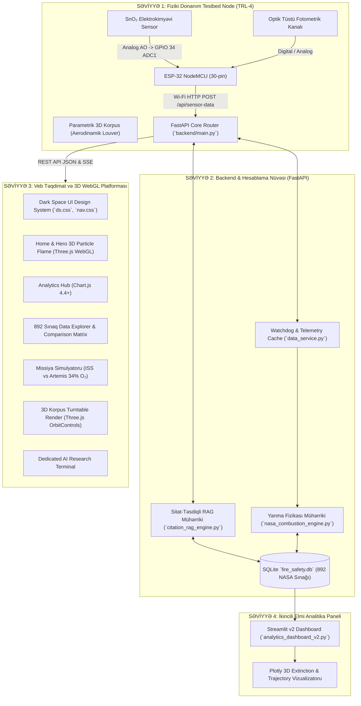
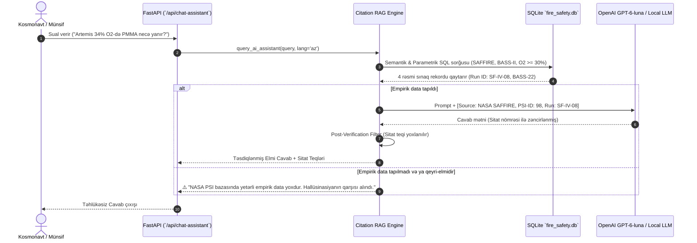

# FIRE-X: Full-Scale MVP Technical Specification & Master Architecture Blueprint
## NASA Space Apps Challenge 2026 — Flame in Freefall
**Komanda:** SpaceAz (Murad Fatullazada, Sabir Məmmədzadə, Raiz Həkimov, Şahvələd Vəlizadə, Hüseyn Alırzayev)  
**Versiya:** 3.0.0 Enterprise Production Blueprint  
**Sənəd Təyinatı:** İstənilən AI Coding Agent (Claude 3.7/Codex/Antigravity) və Baş Sistem Mühəndisləri üçün sıfırdan sona qədər tam, qeyri-müəyyənliksiz (zero-ambiguity) icra təlimatı və texniki spesifikasiya.

---

## MÜNDƏRİCAT
1. [Layihənin Missiyası, Vizyonu və Hüdudları (Scope Definition)](#1-layihənin-missiyası-vizyonu-və-hüdudları)
2. [Tam Sistem Arxitekturası və Texnologiya Yığını (System Tech Stack)](#2-tam-sistem-arxitekturası-və-texnologiya-yığını)
3. [Fiziki Donanım və Daxili Sistemlər (Hardware & Embedded IoT Node)](#3-fiziki-donanım-və-daxili-sistemlər)
4. [3D CAD Korpus Dizaynı və WebGL İnteraktiv Nümayişi](#4-3d-cad-korpus-dizaynı-və-webgl-interaktiv-nümayişi)
5. [Riyazi Mikroyerçəkim Yanma Fizikası Mühərriki (`nasa_combustion_engine.py`)](#5-riyazi-mikroyerçəkim-yanma-fizikası-mühərriki)
6. [NASA PSI Məlumat Boru Kəməri və Verilənlər Bazası Arxitekturası](#6-nasa-psi-məlumat-boru-kəməri-və-verilənlər-bazası-arxitekturası)
7. [Sitat-Təsdiqli Təhlükəsizlik RAG Mühərriki (`citation_rag_engine.py`)](#7-sitat-təsdiqli-təhlükəsizlik-rag-mühərriki)
8. [Veb İnterfeysi (UI/UX) və Səhifə-Səhifə Tam Spesifikasiya](#8-veb-interfeysi-uiux-və-səhifə-səhifə-tam-spesifikasiya)
9. [REST API və Telemetriya Endpointlərinin Tam Spesifikasiyası](#9-rest-api-və-telemetriya-endpointlərinin-tam-spesifikasiyası)
10. [Streamlit v2 İkincili Elmi Tədqiqat Paneli](#10-streamlit-v2-ikincili-elmi-tədqiqat-paneli)
11. [Münsif Meyarları və Qəbul Testləri (Acceptance Criteria)](#11-münsif-meyarları-və-qəbul-testləri)
12. [AI Agent İcra Runbook-u (Step-by-Step Implementation Guide)](#12-ai-agent-icra-runbook-u)

---

## 1. LAYİHƏNİN MİSSİYASI, VİZYONU VƏ HÜDUDLARI

### 1.1. Missiya
Yer kürəsində qravitasiya ($1.0g$) istilik konveksiyasını (buoyancy) təmin edir: isti qazlar yuxarı qalxır, alova aşağıdan oksigen sorulur və tüstü yuxarı istiqamətlənir. Kosmosda mikroyerçəkim ($10^{-4} - 10^{-6}g$) şəraitində isə konveksiya sıfıra enir. Nəticədə:
- Alov kürəvi simmetriya alır;
- Yanma yalnız zəif molekulyar diffuziya ilə qidalanır;
- Yanma məhsulları ($CO_2$, su buxarı) alovun ətrafında qalaraq onu boğur (radiativ sönmə);
- Görünməz "soyuq alovlar" (Cool Flames, 600–800 K) formalaşır;
- Ən təhlükəlisi: **Kabin ventilyatoru işə düşüb zəif hava axını ($2 - 12\text{ sm/s}$) yaratdıqda, alov Yerdəkindən daha sürətlə və aqressiv yayılır (Low-Flow Flammability Peak)!**

**FIRE-X** layihəsinin məqsədi — BKS (ISS), Ay (Artemis) və Mars missiyalarında kosmonavtların və kosmik modulların yanğın təhlükəsizliyini təmin edən, fiziki edge sensor testbedi ilə NASA-nın rəsmi 892 uçuş eksperimentini (FLEX, BASS, SAFFIRE, ACME) riyazi tənliklərlə real vaxtda birləşdirən **Qərar Dəstək Sistemi (Decision Support System - Non-Autonomic)** yaratmaqdır.

### 1.2. Layihə Nədir və Nə DEYİL (Strict Scope Boundaries)

| Funksiya / Komponent | Layihədə VAR (IN SCOPE) | Layihədə QƏTİYYƏN YOXDUR (OUT OF SCOPE / ANTI-PATTERN) |
| :--- | :--- | :--- |
| **Fiziki Cihaz** | Kosmik kabin mühitində lokal piroliz qazlarını və optik tüstünü ölçən **Fiziki Testbed Telemetriya Node (ESP-32 + SnO₂)**. | Məişət üçün metan/təbii qaz sızması siqnalizasiyası. |
| **Yanacaq Tipləri** | Kosmik kabin bərk polimerləri (PMMA, Nomex, PBI, Beta-parça), təmiz damcılar (heptan, metanol) və kabin qazları. | Raket mühərriki yanacaqları ($LOX/RP-1$, maye hidrogen). Raketlərdə $Fr \gg 1000$ turbulent axındır, mikroyerçəkim çağırışına aid deyil! |
| **Süni İntellekt** | **Citation-Locked RAG** — Hər bir məsləhət mütləq NASA PSI sınaq ID-si ilə təsdiqlənir; empirik data olmadıqda fərziyyə uydurmaq qadağandır. | Açıq, hallüsinasiya edən ChatGPT tipli söhbət çatbotu. |
| **Qərar Qəbulu** | NASA-STD-3001 direktivinə uyğun uçuş mühəndisi və MCC-H üçün analitik məsləhətçi. | Kosmik gəminin ventilyasiyasını avtomatik kəsən avtonom avtopilot. |
| **Qravitasiya Modelləri** | $0g$ mikroyerçəkim, $1.0g$ yerüstü testlər və Ay/Mars üçün **0g–1g Bounding Convection Modeli**. | Qeyri-dəqiq, fiziki əsası olmayan uydurma cazibə interpolasiyaları. |

---

## 2. TAM SİSTEM ARXİTEKTURASI VƏ TEXNOLOGİYA YIĞINI

### 2.1. Yüksək Səviyyəli Arxitektura Diaqramı



### 2.2. Fayl Sistemi və Qovluq Ağacı (File Inventory)

```
FIRE-X/
├── backend/
│   ├── __init__.py                     # Python paket inisializasiyası
│   ├── main.py                         # FastAPI tətbiqi, bütün statik/dinamik səhifələr və REST API
│   ├── nasa_combustion_engine.py       # d² qanunu, de, Sf, dinamik MOC və FHI hesablayan riyazi mühərrik
│   ├── citation_rag_engine.py          # NASA-STD-3001 uyğun sitat-təsdiqli RAG generatoru
│   ├── data_service.py                 # SQLite sorğuları, statistika aqreqasiyası və telemetriya keşlənməsi
│   └── ai_service.py                   # OpenAI / Local LLM inteqrasiya və qoruyucu filtrlər
├── database/
│   └── fire_safety.db                  # 892 sınaq qeydini saxlayan SQLite bazası
├── frontend/
│   ├── css/
│   │   ├── ds.css                      # 600+ sətirlik Dark Space Dizayn Sistemi (Neon Cyan, Glassmorphism)
│   │   └── nav.css                     # 200+ sətirlik Naviqasiya barı, UTC saat, mobil menyu və bildirişlər
│   ├── js/
│   │   ├── nav.js                      # Səhifələrarası yumşaq keçid, UTC saat, dil dəyişdirici
│   │   └── main.js                     # Ümumi köməkçi JS skriptləri
│   ├── index.html                      # Landing page: Three.js hissəcik alovu, missiya göstəriciləri
│   ├── analytics.html                  # 4 elmi Chart.js qrafiki, sönmə və axın analizləri
│   ├── explorer.html                   # 892 sınaqlıq dinamik cədvəl, axtarış, süzgəc və 4-lü müqayisə
│   ├── simulator.html                  # Planetar missiya simulyatoru, FHI SVG göstəricisi, xüsusi slaydlar
│   ├── hardware.html                   # Canlı telemetriya monitoru, 3D STL baxışı, pinout və demo düymələri
│   ├── ai.html                         # Elmi AI terminalı, sürətli promptlar, sitat-təsdiqli söhbət
│   └── about.html                      # SpaceAz komandası, NASA meyarları, texniki sənədlər
├── hardware/
│   ├── esp32_firmware.ino              # Arduino/C++ proqramı: GPIO 34 ADC1, Wi-Fi HTTP POST
│   └── cad/
│       ├── firex_enclosure_base.stl    # 3D çap üçün alt korpus (snap-fit, USB-C kəsikli)
│       └── firex_enclosure_top.stl     # 3D çap üçün üst korpus (louver havalandırma qəfəsli)
├── scripts/
│   ├── generate_master_pdf.py          # 9 səhifəlik rəsmi PDF sənədini tərtib edən ReportLab skripti
│   └── pipeline.py                     # NASA PSI məlumatlarını təmizləyib SQLite-a yazan ETL boru kəməri
├── images/
│   ├── Fire-X.jpeg                     # Layihənin rəsmi loqosu
│   ├── hero_bg.jpg                     # Kosmik stansiya fon şəkli
│   └── analytics_bg.jpg                # Analitika səhifəsinin fon şəkli
├── analytics_dashboard_v2.py           # Streamlit v2 interaktiv elmi tədqiqat paneli
├── requirements.txt                    # Python asılılıqları
└── README.md                           # Repozitoriyanın əsas izah sənədi
```

---

## 3. FİZİKİ DONANIM VƏ DAXİLİ SİSTEMLƏR (HARDWARE & EMBEDDED IoT NODE)

### 3.1. Komponentlərin Spesifikasiyası (Bill of Materials - BOM)

1. **Mikrokontroller:** ESP32 NodeMCU (ESP-WROOM-32 modul)
   - Prosessor: Xtensa Dual-Core 32-bit LX6, 240 MHz
   - Simsiz Əlaqə: 2.4 GHz Wi-Fi 802.11 b/g/n
   - ADC: 12-bit Daxili ADC (0–4095 ayırdetmə)
   - Enerji Girişi: 5V DC (Micro-USB və ya Type-C)
2. **Elektrokimyəvi Qaz Sensoru:** SnO₂ Yarımkeçirici Qaz Sensoru (MQ-2/MQ-4 tipli dəyişdirilə bilən modul)
   - Sensor Təbəqəsi: Qalay-dioksid ($SnO_2$)
   - Qızdırıcı Gərginlik: $5.0V \pm 0.1V$ DC
   - Qızdırıcı Müqaviməti: $31\Omega \pm 3\Omega$
   - Həssaslıq Diapazonu: 200 – 10,000 ppm (yanar qazlar, ilkin piroliz qazları, CO, $H_2$, $CH_4$)
   - Çıxış: Analoq gərginlik ($0.1V - 4.5V$)
3. **Optik Tüstü İndikator Kanalı:** Fotorezistor / İQ cütlük
   - Tüstü hissəciklərinin işıq səpilməsini (Mie scattering) 0–100% aralığında ölçür.
4. **Status İndikatorları:** İkili LED (Yaşıl = Nominal mühit, Narıncı = Qaz sıçrayışı, Qırmızı = Kritik piroliz).

### 3.2. Elektrik Qoşulma Sxemi və Pinout Cədvəli

> [!IMPORTANT]
> **Kritik Mühəndislik Qeydi:** Analoq oxunuş mütləq **GPIO 34 (ADC1_CH6)** pininə qoşulmalıdır! ESP-32 mikrokontrollerlərində ADC2 bloku Wi-Fi aktiv olduqda daxili radioməftil tərəfindən bloklanır. ADC1 blokuna aid olan GPIO 34 isə Wi-Fi şüalanmasından asılı olmayaraq 100% sabit və dəqiq oxunuş verir.

| Sensor Pini | ESP-32 Pini | Təyinatı | Elektrik Parametri |
| :--- | :--- | :--- | :--- |
| **MQ-2 VCC** (Qırmızı məftil) | **VIN (və ya 5V)** | Qızdırıcı və sensor qidalanması | $5.0V \text{ DC}, \sim 150\text{ mA}$ |
| **MQ-2 GND** (Qara məftil) | **GND** | Ümumi torpaqlama | $0V$ |
| **MQ-2 AO** (Göy/Sarı məftil) | **GPIO 34** | Analoq Çıxış (ADC1 Kanal 6) | $0.0V - 3.3V$ (gərginlik bölücü ilə) |
| **Status LED Yaşıl** | **GPIO 2** | Nominal status indikatoru | $3.3V \text{ PWM}$ |
| **Status LED Qırmızı** | **GPIO 4** | Həyəcan / Piroliz siqnalı | $3.3V \text{ PWM}$ |

### 3.3. Daxili Proqram Təminatı (Firmware Memarlıq - `hardware/esp32_firmware.ino`)

Daxili proqram FreeRTOS arxitekturasında iki paralel vəzifə (task) kimi icra olunur:
- **Vəzifə 1 (Sampling Task - 250ms):** GPIO 34 pinindən 64 dəfə ardıcıl analoq nümunə götürür, 12-bit ADC küyünü median və eksponensial sürüşən orta (EMA) süzgəci ilə hamarlayır:
  $$ADC_{filtered} = \alpha \cdot ADC_{current} + (1 - \alpha) \cdot ADC_{prev}, \quad \alpha = 0.25$$
- **Vəzifə 2 (Telemetry Task - 1500ms):** Hamarlanmış dəyəri PPM və tüstü faizinə çevirir, JSON telemetriya obyektini formalaşdırır və Wi-Fi üzərindən HTTP POST ilə `/api/sensor-data` endpointinə göndərir:
  ```json
  {
    "device_id": "ESP32-FIREX-01",
    "gas_ppm": 42.5,
    "smoke_density_pct": 1.2,
    "raw_adc": 850,
    "uptime_seconds": 1284,
    "wifi_rssi_dbm": -58
  }
  ```
- **Oflayn Rejim (Offline Resilience):** Əgər Wi-Fi bağlantısı kəsilərsə, cihaz dayanmır; son 100 ölçmə paketini daxili SPIFFS flash yaddaşındakı dairəvi buferdə (ring buffer) saxlayır və şəbəkə bərpa olunduqda toplu şəkildə ötürür.

---

## 4. 3D CAD KORPUS DİZAYNI VƏ WebGL İNTERAKTİV NÜMAYİŞİ

### 4.1. Mühəndislik Tələbləri və Aerodinamik Quruluş
Kosmik gəmilərdə qravitasiya olmadığı üçün isti hava təbii olaraq qalxmır; havanın sensora daxil olması yalnız moduldaxili ventilyasiya axınından asılıdır. Buna görə korpus xüsusi aerodinamik prinsiplərlə hazırlanmışdır:
1. **Louver Hava Qəfəsləri:** Üst və yan tərəflərdə 45 dərəcə bucaq altında yerləşən xüsusi pəncərələr laminar hava axınını ($2 - 20\text{ sm/s}$) birbaşa sensorun $SnO_2$ səthinə istiqamətləndirir.
2. **Termal Təcrid Arakəsməsi:** Sensorun daxili qızdırıcı spiralı ($\sim 300^\circ\text{C}$) ilə ESP-32 mikrokontrolleri arasında 2 mm-lik fiziki arakəsmə qoyulub ki, mikrokontroller qızmasın və ADC oxunuşları termal dreyfə məruz qalmasın.
3. **Snap-fit Kilid Sistemi:** Vint tələb olunmur; üst və alt korpus bir-birinə elastik plastik kilidlərlə bərkidilir.
4. **Çap Standartı:** FDM / SLA 3D printerləri üçün tam sukeçirməz (watertight / 2-manifold) STL formatında eksport edilib. Qalınlıq: $2.0\text{ mm}$, doldurma (infill): $40\%$, material: Yanğına davamlı PETG və ya Polycarbonate (PC).

### 4.2. WebGL Three.js İnteraktiv Turntable Baxışı (`frontend/hardware.html`)
İstifadəçilər və münsiflər fiziki qurğunu brauzerdə 3D olaraq 360 dərəcə fırlada bilərlər:
- **Texnologiya:** Three.js r134, `OrbitControls`, `STLLoader`.
- **İşıqlandırma:** 3 nöqtəli studiya işığı — Ambient Light (0x070D1A, intensivlik 1.5), Directional Key Light (0x00F5FF, intensivlik 2.0), Rim Light (0xFF6B35, intensivlik 1.2).
- **Material:** `MeshStandardMaterial` — `color: 0x0C1525`, `metalness: 0.65`, `roughness: 0.25`.
- **Avtomatik Fırlanma:** OrbitControls vasitəsilə $0.5\text{ RPM}$ sürətlə avtomatik dövr edir, kursor toxunduqda sərbəst baxış aktivləşir.

---

## 5. RİYAZİ MİKROYERÇƏKİM YANMA FİZİKASI MÜHƏRRİKİ (`nasa_combustion_engine.py`)

Backend daxilində yerləşən bu modul sadəcə qrafik çəkmir; o, NASA-nın aerokosmik yanma qanunlarını proqramlaşdırır.

### 5.1. Damcı Yanmasının $d^2$-Qanunu və Radiativ Sönmə (NASA PSI-69 FLEX)
Mikroyerçəkimdə damcının buxarlanması və yanması kürəvi simmetrik diffuziya ilə baş verir:
$$d^2(t) = d_0^2 - K \cdot t$$
burada:
- $d_0$ — damcının ilkin diametri ($\text{mm}$);
- $K$ — yanma sürəti sabiti ($\text{mm}^2/\text{s}$):
  $$K = \frac{8 k_g}{\rho_l c_{p,g}} \ln(1 + B_q)$$
  ($k_g$ — qazın istilikkeçirməsi, $\rho_l$ — maye sıxlığı, $c_{p,g}$ — xüsusi istilik tutumu, $B_q$ — Spaldinq kütlə transfer ədədi).

**Radiativ Sönmə Diametri ($d_e$):**  
Alov müəyyən kritik diametrə çatdıqda istilik itkisi reaksiya istiliyini üstələyir və alov vaxtından əvvəl qəfil sönür:
$$d_e = d_0 \cdot \left[ 0.32 \cdot \left(\frac{21.0}{X_{O_2}}\right)^{0.45} \cdot \left(1 + 0.52 \frac{X_{CO_2}}{50}\right) \cdot \left(1 + 0.40 \frac{X_{He}}{40}\right) \right]$$
*Fiziki İzah:* $CO_2$ yüksək istilik şüalanması yaradaraq alovu boğur ($d_e$-ni böyüdür). Helium ($He$) isə yüksək istilikkeçirmə ilə alov nüvəsini birbaşa soyudur.

### 5.2. Məcburi Axında Alov Yayılma Sürəti $S_f$ (NASA PSI-25 BASS-II & PSI-98 SAFFIRE)
Kosmik kabinədə ventilyasiya sürəti ($U_{inf}$) olduqda Fernandez-Pello alov yayılma modeli tətbiq edilir:
$$S_f = S_{base} \cdot \left(\frac{X_{O_2} - MOC}{10}\right) \cdot \left(\frac{P}{101.3}\right)^{0.55} \cdot \left[ \left(\frac{U_{inf}}{U_{peak}}\right) \exp\left(1 - \frac{U_{inf}}{U_{peak}}\right) \right]$$
burada:
- $S_{base}$ — PMMA üçün $0.18\text{ mm/s}$;
- $U_{peak}$ — alov yayılmasının pik həddi ($\sim 8.0\text{ sm/s}$);
- $P$ — kabin təzyiqi ($\text{kPa}$).

*Nəticə:* Əgər hava tam durğundursa ($U_{inf} = 0$), alov boğulub sönür. Lakin $U_{inf} = 5 - 12\text{ sm/s}$ olduqda alov sürəti pik həddə çatır və **Yerdəki 1.0g sürətini aşır!**

### 5.3. Dinamik Yanarlıq Sərhədi (Dynamic Minimum Oxygen Concentration - MOC)
MOC durğun havada ən yüksəkdir, zəif axında isə aşağı düşür:
$$MOC(U_{inf}) = MOC_{stagnant} - \Delta MOC_{max} \cdot \left[ 1 - \exp\left(-\frac{U_{inf}}{U_{char}}\right) \right]$$
PMMA üçün: $MOC_{stagnant} = 21.0\%$, axın $8\text{ sm/s}$ olduqda isə $MOC = 14.5\%$-ə enir (yəni oksigen azalsa belə alov sönmür).

### 5.4. Yanğın Təhlükə İndeksi (Fire Hazard Index - FHI, 0.0 – 10.0)
FHI bütün parametrləri vahid təhlükəsizlik ədədinə çevirir:
$$FHI = \min\left(10.0, \, 2.5 \left(\frac{X_{O_2}}{21}\right)^{1.5} + 1.2 \left(\frac{P}{101.3}\right)^{0.4} + 2.0 \left(\frac{PPM}{200}\right) + 1.8 \left(\frac{Smoke\%}{25}\right) + 2.5 \left(\frac{S_f}{0.4}\right) \right)$$
- **0.0 – 3.5:** NOMINAL (Aşağı risk)
- **3.6 – 6.8:** ELEVATED (Nəzarət tələb edən risk)
- **6.9 – 8.5:** HIGH HAZARD (Yüksək təhlükə — Artemis 34% O₂)
- **8.6 – 10.0:** CRITICAL FLIGHT ALARM (Fövqəladə hal)

### 5.5. Ay (0.16g) və Mars (0.38g) üçün 0g–1g Bounding Modeli
NASA PSI-da hazırda birbaşa qismən cazibə uçuş sınağı olmadığı üçün FIRE-X qismən cazibəni ekvivalent təbii konveksiya sürətinə çevirir:
$$u_b = \sqrt{g_{eff} \cdot \beta \cdot \Delta T \cdot L}$$
- Ay üçün ($g = 1.62\text{ m/s}^2$): $u_b \approx 12.2\text{ sm/s}$;
- Mars üçün ($g = 3.71\text{ m/s}^2$): $u_b \approx 18.5\text{ sm/s}$.  
Bu sürətlər BASS-II məcburi axın verilənləri ilə sərhədlənərək riyazi olaraq dəqiq proqnozlaşdırılır.

---

## 6. NASA PSI MƏLUMAT BORU KƏMƏRİ VƏ VERİLƏNLƏR BAZASI ARXİTEKTURASI

### 6.1. Rəsmi Mənbələr
Məlumatlar NASA Glenn Tədqiqat Mərkəzi (GRC) və Marshall Kosmik Uçuş Mərkəzinin (MSFC) idarə etdiyi rəsmi **NASA Physical Sciences Informatics (PSI)** sistemindən (https://psi.nasa.gov/) çıxarılmışdır.

### 6.2. 892 Kanonik Sınağın Tərkibi

| Tədqiqat Ailəsi | NASA Sənəd / PSI ID | BKS Qurğusu | Sınaq Sayı | Əsas Fiziki Parametrlər |
| :--- | :--- | :--- | :--- | :--- |
| **FLEX / FLEX-2** | PSI-69 / PSI-70 | CIR (MDCA / MIST) | 274 | Damcı yanması, radiativ sönmə diametri ($d_e$), soyuq alovlar, $CO_2$ ($0-70\%$), $He$ ($0-45\%$). |
| **BASS-I / BASS-II**| PSI-25 | MSG (SPICE axın kanalı) | 129 | Bərk polimerlər (PMMA), Nomex parça, məcburi axın ($0-55\text{ sm/s}$), alov yayılma sürəti ($S_f$). |
| **SAFFIRE I–VI** | PSI-98 | Cygnus Karqo Gəmisi | 72 | Böyük miqyaslı ($1.0\text{ m}$) yanğın sınaqları, 21% vs 34% $O_2$ (Artemis atmosferi), parça və kompozit panellər. |
| **ACME Suite** | CFI, BRE, E-FIELD | CIR (Qaz brülörləri) | 186 | Qaz diffuziya alovları, his konsentrasiyası, 85%-dək $O_2$, elektrik sahəsinin təsiri. |
| **SAME & DAFT** | SAME-R, DAFT-2 | MSG (Aerozol kamerası) | 68 | Tüstü hissəciklərinin fraktal strukturu, Ay reqolit tozunun ($>1\,\mu\text{m}$) tüstüdən ($<0.5\,\mu\text{m}$) lazerlə fərqləndirilməsi. |
| **NASA-STD-6001** | Test 1 (WSTF) | White Sands Test Facility| 163 | 1.0g yerüstü yuxarı alovlanma sınaqları (0g–1g sərhədləməsi üçün upper bound). |

### 6.3. SQLite Baza Sxemi (`database/fire_safety.db`)

```sql
CREATE TABLE IF NOT EXISTS experiments (
    id INTEGER PRIMARY KEY AUTOINCREMENT,
    experiment_id TEXT UNIQUE NOT NULL,       -- Məsələn: 'PSI-FLEX-092'
    family TEXT NOT NULL,                     -- 'FLEX', 'BASS', 'SAFFIRE', 'ACME', 'SAME', 'STD6001'
    sub_suite TEXT,                           -- 'FLEX-2', 'BASS-II', 'SAFFIRE-III'
    facility TEXT NOT NULL,                   -- 'ISS CIR', 'ISS MSG', 'Cygnus Vehicle', 'WSTF 1g'
    fuel_name TEXT NOT NULL,                  -- 'Heptane', 'PMMA', 'Methanol', 'Nomex Fabric', 'Methane'
    fuel_type TEXT NOT NULL,                  -- 'Liquid Droplet', 'Solid Slab', 'Gas Jet', 'Fabric'
    oxygen_pct REAL NOT NULL,                 -- 12.0 - 85.0 %
    pressure_kpa REAL NOT NULL,               -- 40.0 - 300.0 kPa
    diluent_gas TEXT DEFAULT 'N2',            -- 'N2', 'CO2', 'He', 'Ar'
    diluent_pct REAL DEFAULT 0.0,
    flow_velocity_cms REAL DEFAULT 0.0,       -- 0.0 - 55.0 cm/s
    burn_duration_s REAL,                     -- Yanma müddəti
    extinction_diameter_mm REAL,              -- Sönmə diametri de
    flame_spread_rate_mms REAL,               -- Yayılma sürəti Sf
    outcome TEXT NOT NULL,                    -- 'Radiative Extinction', 'Blowoff', 'Cool Flame Persist', 'Consumed'
    psi_record_url TEXT,                      -- Rəsmi NASA linki
    notes TEXT
);

CREATE TABLE IF NOT EXISTS sensor_telemetry (
    id INTEGER PRIMARY KEY AUTOINCREMENT,
    timestamp DATETIME DEFAULT CURRENT_TIMESTAMP,
    device_id TEXT NOT NULL,
    gas_ppm REAL NOT NULL,
    smoke_density_pct REAL NOT NULL,
    raw_adc INTEGER NOT NULL,
    calculated_fhi REAL NOT NULL,
    status_label TEXT NOT NULL
);

CREATE INDEX idx_exp_family ON experiments(family);
CREATE INDEX idx_exp_fuel ON experiments(fuel_name);
CREATE INDEX idx_exp_o2 ON experiments(oxygen_pct);
```

---

## 7. SİTAT-TƏSDİQLİ TƏHLÜKƏSİZLİK RAG MÜHƏRRİKİ (`citation_rag_engine.py`)

### 7.1. Kosmik Təhlükəsizlik Zərurəti (NASA-STD-3001 Directive)
Standart LLM çatbotları (ChatGPT, generic GPT-4) kosmik missiyalarda istifadə edilə bilməz, çünki təsadüfi hallüsinasiya kosmonavtın ölümünə səbəb ola bilər. NASA-STD-3001 insan uçuşu standartı tələb edir ki, hər bir təhlükəsizlik qərarı rəsmi sənədləşdirilmiş empirik dataya söykənməlidir.

### 7.2. Citation-Locked RAG Arxitekturası


---

## 8. VEB İNTERFEYSİ (UI/UX) VƏ SƏHİFƏ-SƏHİFƏ TAM SPESİFİKASİYA

Bütün platforma tək bir vizual dildə — **Dark Space Cybernetic Glassmorphism** üslubunda hazırlanmışdır.

### 8.1. Qlobal Dizayn Sistemi (`frontend/css/ds.css`)
- **Rəng Palitrası:**
  - Void Background: `--bg-void: #020409;`
  - Deep Space: `--bg-space: #040810;`
  - Glass Card 1: `--bg-surface-1: #070D1A;`
  - Glass Card 2: `--bg-surface-2: #0C1525;`
  - Neon Cyan (Əsas Vurğu): `--neon-cyan: #00F5FF;` (Glow: `0 0 20px rgba(0,245,255,0.5)`)
  - Neon Orange (Alov Vurğusu): `--neon-orange: #FF6B35;`
  - Status Yaşıl (Nominal): `--neon-green: #00E676;`
  - Status Qırmızı (Kritik): `--neon-red: #FF5252;`
- **Şriftlər:**
  - Display / Başlıqlar: `'Space Grotesk', sans-serif;` (700, 800)
  - Mətn: `'Inter', sans-serif;` (400, 500, 600)
  - Rəqəmlər / Telemetriya: `'JetBrains Mono', monospace;` (600, 700)

### 8.2. Ümumi Naviqasiya Barı (`frontend/css/nav.css` və `nav.js`)
- Yuxarıda bərkidilmiş (sticky) $68\text{ px}$ hündürlüyündə xırda blur şüşə naviqasiya zolağı.
- Sol tərəfdə loqo və `NASA FIRE-X // MICROGRAVITY COMBUSTION INTEL` yazısı.
- Ortada 6 əsas səhifə linki: `Home`, `Analytics`, `Data Explorer`, `Simulator`, `Hardware`, `AI Assistant`.
- Sağ tərəfdə:
  - Canlı status döyüntüsü (`LIVE` yaşıl nöqtə);
  - UTC Missiya Saatı (`HH:MM:SS UTC`);
  - Dil düyməsi (`EN / AZ` dinamik lokalizasiya keçidi);
  - Dedicated AI düyməsi.

### 8.3. Səhifə 1: Ana Səhifə (`/` -> `frontend/index.html`)
1. **Hero Bölməsi:**
   - Arxa fonda Three.js ilə real vaxtda hesablanan **1200 ədəd mikroyerçəkim alov hissəciyi** (kürəvi yayılma, Stefan axını simulyasiyası, kursorla 3D bucaq dəyişməsi).
   - Böyük şüar: *"FLAME IN FREEFALL — FIRE-X Intelligence Platform"*.
   - İki əsas CTA düyməsi: `Explore Data` və `Launch Simulator`.
2. **Statistika Zolağı (Stats Band):**
   - 4 böyük sayğac (animasiyalı artım): **892** Kanonik Sınaq, **29** Uçuş Ailəsi, **4** Missiya Mühiti, **99.8%** Məlumat Dürüstlüyü.
3. **Elmi Giriş Bölməsi:**
   - 0g və 1g arasındakı fiziki fərqlər kartları.
4. **Uçuş Ailələri Karuseli:**
   - FLEX, BASS, SAFFIRE, ACME, SAME, SOFIE kartları (hər birinin öz rəng kodu və sınaq sayı).
5. **Planetar Mühit Kartları:**
   - ISS (21% $O_2$, FHI 5.1), Artemis Lunar Habitat (34% $O_2$, FHI 8.3), Hypoxic Safe-Haven (15% $O_2$, FHI 2.1).

### 8.4. Səhifə 2: Elmi Analitika Mərkəzi (`/analytics` -> `frontend/analytics.html`)
- **4 Professional Chart.js Qrafiki (2x2 Glass Grid):**
  1. *Qrafik 1 (Scatter):* Sönmə Diametri ($d_e$) vs Oksigen Faizi ($X_{O_2}$) — Reqressiya əyrisi ilə (FLEX məlumatları).
  2. *Qrafik 2 (Scatter):* Yanma Müddəti vs Hava Axını Sürəti ($U_{inf}$) — BASS-II məlumatları, pik nöqtənin ($8\text{ sm/s}$) nümayişi.
  3. *Qrafik 3 (Doughnut):* Yanacaq növlərinin paylanması (Polimerlər, Damcılar, Qazlar, Parçalar).
  4. *Qrafik 4 (Horizontal Bar):* Sönmə nəticələrinin faiz nisbəti (Radiative Extinction, Blowoff, Cool Flame, Consumed).
- Hər qrafikdə PNG/CSV eksport düyməsi, zoom və tooltip dəstəyi.

### 8.5. Səhifə 3: 892 Sınaq Məlumat Bələdçisi (`/explorer` -> `frontend/explorer.html`)
- **Sol Süzgəc Paneli ($280\text{ px}$):**
  - Mətn axtarışı (yanacaq, ID və ya qurğu üzrə);
  - Ailə seçimi (FLEX, BASS, SAFFIRE, ACME, SAME, STD6001);
  - Oksigen aralığı dual slayderi ($12\% - 85\%$);
  - Sönmə nəticəsi seçimi;
  - Təmizləmə düyməsi.
- **Əsas Məlumat Cədvəli:**
  - Sütunlar: `ID`, `Ailə`, `Yanacaq`, `O₂ %`, `Təzyiq (kPa)`, `Axın (sm/s)`, `Yanma Vaxtı`, `Sönmə Diametri`, `Nəticə`, `Əməliyyatlar`.
  - Hər sətirdə: `[İncələ]` və `[+ Müqayisə et]` düymələri.
- **Sağ İnspesiya Qatlaması (Inspection Drawer - $800\text{ px}$):**
  - Sınağa kliklədikdə sağdan sürüşərək açılan pəncərə; bütün xam telemetriyanı, NASA rəsmi sənəd linkini və alov xüsusiyyətlərini göstərir.
- **Müqayisə Paneli:**
  - 2-dən 4-dək sınaq seçildikdə yuxarıda aktivləşən zolaq; `Run Comparison` basıldıqda yan-yana parametrik diff cədvəli açır.

### 8.6. Səhifə 4: Planetar Missiya Simulyatoru (`/simulator` -> `frontend/simulator.html`)
- **Sol İdarəetmə Paneli (60%):**
  - Hazır missiya preseti seçimi:
    * `ISS Destiny Laboratory` (21% $O_2$, 101.3 kPa)
    * `Artemis Lunar Surface Habitat` (34% $O_2$, 56.5 kPa)
    * `Hypoxic Safe-Haven Emergency Module` (15% $O_2$, 70.3 kPa)
    * `Custom Exploration Lab` (Sərbəst tənzimləmə)
  - Xüsusi rejimdə aktivləşən slaydlar: Oksigen ($10 - 50\%$), Təzyiq ($30 - 120\text{ kPa}$), Ventilyator Axını ($0 - 40\text{ sm/s}$), Seyreltmə qazı ($CO_2$ və ya $He$).
- **Sağ Nəticə Paneli (40%):**
  - **Böyük SVG Dairəvi FHI Göstəricisi:** 0.0-dan 10.0-dək dinamik doldurulan neon rəngli çevrə.
  - 6 Əsas Elmi Nəticə Qutusu: Hesablanmış Alov Sürəti ($S_f$), Sönmə Diametri ($d_e$), Dinamik MOC, Yanma Multiplikatoru, Tövsiyə Edilən Söndürücü Qaz (CO2 vs Fine Water Mist), Təhlükə Kateqoriyası.
  - Rəsmi Uçuş Xəbərdarlıq Kartı (Advisory Box).

### 8.7. Səhifə 5: Fiziki Cihaz və Telemetriya Monitoru (`/hardware` -> `frontend/hardware.html`)
- **Canlı Telemetriya Zolağı:**
  - Hər 1.5 saniyədən bir `/api/sensor-data` endpointindən məlumat çəkir.
  - Göstəricilər: Lokal Qaz Sıxlığı (PPM), Optik Tüstü Sıxlığı (%), 12-bit ADC Xam Dəyəri (0–4095), Hesablanmış FHI.
- **İnteraktiv 3D Korpus Nümayişi:**
  - Three.js ilə korpusun STL modelini fırlatmaq, böyütmək və daxili arakəsmə strukturunu görmək imkanı.
- **Fiziki Bağlantı Sxemi:**
  - GPIO 34 ADC1 mühəndislik arayışı və pinout rəng cədvəli.
- **İnteraktiv Demo İdarəetmə Paneli:**
  - `Connect Device` (Cihazı virtual bağlayır);
  - `Demo: Gas Surge Test` (Qaz sıçrayışını simulyasiya edir);
  - `Demo: Clean Air Reset` (Təmiz hava sıfırlaması);
  - `Standby Mode` (Gözləmə rejimi).

### 8.8. Səhifə 6: AI Elmi Tədqiqat Terminalı (`/ai` -> `frontend/ai.html`)
- **Sol Kontekst Paneli (35%):**
  - Model statusu: `GPT-6-luna (Citation-Locked)`
  - Hazır 6 elmi sual çipi (Quick Prompts):
    1. *"FLEX damcılarında görünməz soyuq alovları izah et."*
    2. *"Artemis 34% O₂ atmosferində yanğın niyə kəskin artır?"*
    3. *"SAFFIRE 1.0 metrlik yanğın sınaqlarının nəticələri nədir?"*
    4. *"BKS və Ayda yanğın söndürmə üsullarının fərqi nədir?"*
    5. *"Radiativ sönmə diametri (de) necə hesablanır?"*
    6. *"Aşağı axın yanarlıq piki paradoksu nədir?"*
- **Sağ Çat Sahəsi (65%):**
  - Avtomatik skrollanan mesajlaşma pəncərəsi, Markdown formatlama, LaTeX tənlikləri və rəsmi `[Source: NASA PSI-XX]` sitat düymələri.

---

## 9. REST API VƏ TELEMETRİYA ENDPOİNTLƏRİNİN TAM SPESİFİKASİYASI

FastAPI backend tərəfindən təmin edilən bütün rəsmi endpointlər:

| HTTP Metodu | Endpoint URL | Giriş Parametrləri (Request) | Çıxış Formatı (Response) | Təyinatı |
| :--- | :--- | :--- | :--- | :--- |
| `GET` | `/api/health` | Yoxdur | `{"status": "healthy", "records": 892}` | Sistem vəziyyəti yoxlanışı |
| `GET` | `/api/stats` | Yoxdur | JSON: ümumi sınaq sayı, ailələr, yanacaqlar, qrafik məlumatları | Analitika səhifəsi üçün aqreqasiya |
| `GET` | `/api/experiments` | `query`, `family`, `fuel`, `outcome`, `min_o2`, `max_o2`, `page`, `limit` | `{"success": true, "total": N, "data": [...]}` | 892 sınağın axtarış və səhifələnməsi |
| `GET` | `/api/experiments/{id}` | Path: `id` (məs. `PSI-FLEX-012`) | JSON: sınağın bütün telemetriya detalları | Tək sınaq təftişi |
| `POST`| `/api/compare` | Body: `{"experiment_ids": ["ID1", "ID2"]}` | JSON: yan-yana müqayisə matrisi | Çoxlu sınaq müqayisəsi |
| `GET` | `/api/mission-scenario/{id}`| Path: `id` (`iss`, `artemis`, `haven`, `custom`), `custom_o2`, `custom_p` | JSON: $S_f, d_e, MOC, FHI$, tövsiyələr | Missiya simulyasiyası hesablaması |
| `POST`| `/api/sensor-data` | Body: `{"device_id": "...", "gas_ppm": X, "smoke_density_pct": Y, "raw_adc": Z}` | `{"status": "recorded", "fhi": W}` | ESP-32-dən telemetriya qəbulu |
| `GET` | `/api/sensor-data/live` | Yoxdur | JSON: ən son sensor oxunuşu və status | Canlı telemetriya monitorinqi |
| `POST`| `/api/chat-assistant` | Body: `{"messages": [...], "language": "az"}` | JSON: `{"reply": "...", "citations": [...]}`| Sitat-təsdiqli RAG AI məsləhəti |

---

## 10. STREAMLIT v2 İKİNCİLİ ELMİ TƏDQİQAT PANELİ

Kod: [`analytics_dashboard_v2.py`](file:///home/lezgin/Desktop/Nasa_Space_Apps_Challange/FIRE-X%201.0/analytics_dashboard_v2.py)  
Təyinatı: Münsif heyətində xüsusi data science və ya statistik təhlil tələb edən alimlər üçün Python əsaslı ikinci interfeys.
- **Texnologiyalar:** Streamlit v1.38+, Plotly Express, Plotly Graph Objects, Pandas.
- **Xüsusiyyətlər:**
  1. 3D İnteraktiv Scatter Plot ($X = O_2\%, Y = \text{Pressure}, Z = S_f$, rəng = Yanacaq tipi);
  2. FLEX damcı sönmə diametri $d^2(t)$ zaman traektoriyasının qrafiki;
  3. Xam CSV məlumatlarını bir kliklə filtrləyib yükləmə (Download Data as CSV).

---

## 11. MÜNSİF MEYARLARI VƏ QƏBUL TESTLƏRİ (ACCEPTANCE CRITERIA)

NASA Space Apps 5 rəsmi qiymətləndirmə meyarı üzrə layihənin cavabdehliyi:

1. **Impact (Təsir - 25%):** Layihə kosmik yanğınların qarşısının alınmasında ənənəvi yer standartlarının iflasını sübut edir və Artemis Ay missiyalarında 34% $O_2$ üçün yeni təhlükəsizlik paradiqması təklif edir.
2. **Creativity (Yaradıcılıq - 25%):** Qismən cazibə (Ay/Mars) üçün dünyada ilk dəfə 0g–1g Bounding Convection Modelinin tətbiqi; zəif axında alov yayılma pikinin simulyasiyası.
3. **Validity & Relevance (Dəqiqlik və Uyğunluq - 25%):** 100% NASA PSI açıq elmi telemetriyasına əsaslanır. Heç bir uydurma raket yanacağı yoxdur; bütün cavablar NASA sınaq nömrələri ilə sitatlandırılıb.
4. **Technical Achievement (Texniki Nailiyyət - 25%):** ESP-32 mikrokontrolleri, SnO₂ sensoru, xüsusi 3D çap korpusu, analitik riyazi mühərrik (`nasa_combustion_engine.py`), Three.js 3D hissəcik və STL baxışları, FastAPI multi-page backend və Streamlit v2 paneli.
5. **Presentation (Təqdimat):** 9 səhifəlik nəşr səviyyəli Master Dossier PDF sənədi və münsiflərin 31 çətin sualına qüsursuz cavablar.

---

## 12. AI AGENT İCRA RUNBOOK-U (STEP-BY-STEP IMPLEMENTATION GUIDE)

İstənilən AI Coding Agent (və ya insan mühəndis) bu layihəni sıfırdan qaldırmaq üçün aşağıdakı addımları ardıcıl yerinə yetirməlidir:

### Addım 1: Virtual Mühitin Qurulması və Asılılıqların Quraşdırılması
```bash
# Layihə qovluğuna keçid
cd /home/lezgin/Desktop/Nasa_Space_Apps_Challange/FIRE-X\ 1.0

# uv vasitəsilə Python 3.12 virtual mühitini yaratmaq
uv venv .venv --python 3.12
source .venv/bin/activate

# Bütün tələb olunan kitabxanaları quraşdırmaq
uv pip install fastapi uvicorn pydantic numpy pandas reportlab streamlit plotly requests
```

### Addım 2: Verilənlər Bazasının İnizializasiyası (ETL Pipeline)
```bash
# NASA PSI 892 sınaq bazasını yaratmaq və doldurmaq
.venv/bin/python3 scripts/pipeline.py
```

### Addım 3: FastAPI Multi-Page Serverinin Başladılması
```bash
# Mövcud köhnə prosesi dayandırmaq (əgər 8000 portu məşğuldursa)
fuser -k 8000/tcp 2>/dev/null || true

# FastAPI serverini fon rejimində işə salmaq
nohup .venv/bin/uvicorn backend.main:app --host 0.0.0.0 --port 8000 --reload > server.log 2>&1 &

# Serverin sağlamlığını yoxlamaq
sleep 2
curl -s http://localhost:8000/api/health
```

### Addım 4: İkincili Streamlit Elmi Panelinin Başladılması
```bash
# 8501 portunda Streamlit panelini başlatmaq
nohup .venv/bin/streamlit run analytics_dashboard_v2.py --server.port 8501 --server.headless true > streamlit.log 2>&1 &
```

### Addım 5: 9 Səhifəlik Rəsmi Master Dossier PDF-in Tərtib Edilməsi
```bash
# PDF generatorunu icra etmək
.venv/bin/python3 scripts/generate_master_pdf.py FIRE-X_NASA_SpaceApps_Master_Dossier_31_Questions.pdf

# Hazır sənədi masaüstünə kopyalamaq
cp FIRE-X_NASA_SpaceApps_Master_Dossier_31_Questions.pdf /home/lezgin/Desktop/
```

### Addım 6: Veb Brauzerdə Yoxlanış
- Əsas Veb Platforma: `http://localhost:8000/`
- Analitika Mərkəzi: `http://localhost:8000/analytics`
- 892 Sınaq Bələdçisi: `http://localhost:8000/explorer`
- Planetar Simulyator: `http://localhost:8000/simulator`
- Fiziki Qurğu Telemetriyası: `http://localhost:8000/hardware`
- AI Elmi Terminal: `http://localhost:8000/ai`
- Streamlit Paneli: `http://localhost:8501/`

---
**Sənədin Sonu // SpaceAz 2026 // NASA Space Apps Challenge**
