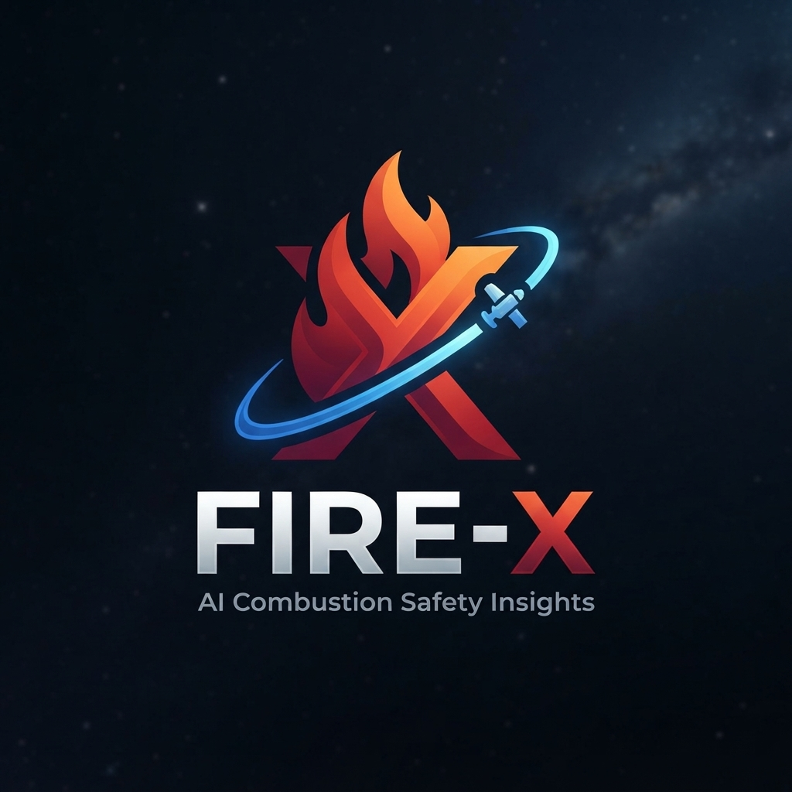

<div align="center">



# NASA FIRE-X
### *Flame in Freefall: SI-Powered (Super Intelligence / AI) Fire Safety Insights from Microgravity Combustion Data*

**Microgravity combustion intelligence meets autonomous OpenAI reasoning + Live SQLite SQL-RAG & 3D/4D telemetry. Instant insights derived from 892 verified NASA orbital & ground-bound experiments across 29 investigation suites.**

[🌐 Multi-Page Platform](https://fire-x.onrender.com/) · [⚡ Quick Start](#-quick-start) · [🔬 3D Holo-Lab](#-3d4d-combustion-holo-lab) · [📖 API Reference](#-api-endpoints) · [🛰️ Data Sources](#-nasa-open-datasets-catalog--provenance) · [☁️ Free Deployment](#-free-cloud--self-hosting-deployment)

<p align="center">
  
  
  
  
  
  
  
  
</p>

### 👥 Team SpaceAz (NASA Space Apps Ganja 2026)
| Member | Role | Engineering Focus |
|:---|:---|:---|
| **Murad Fatullazada** | **Team Leader & Hardware Lead** | Physical Testbed Edge Node, ESP-32 firmware, 3D CAD parametric enclosure |
| **Sabir Məmmədzadə** | **Backend & Systems Architect** | FastAPI multi-page backend, NASA combustion physics engine, REST endpoints |
| **Raiz Həkimov** | **Frontend & 3D WebGL Lead** | Three.js WebGL visualization, cybernetic UI/UX design system, bilingual engine |
| **Şahvələd Vəlizadə** | **Cybersecurity & Safety Architect** | Anti-hallucination guardrails, citation verification pipeline, API rate limiting |
| **Hüseyn Alırzayev** | **Data Scientist & Modeling Lead** | NASA PSI data ingestion, empirical flame spread models, Streamlit analytics panel |

</div>

---

> ### ⚠️ OFFICIAL SYSTEM SAFETY DIRECTIVE (NASA-STD-3001)
> **FIRE-X Decision Support System — Empirical Analytics & Reference Tool (Non-Autonomic).**  
> Every prediction and AI recommendation is strictly citation-locked to peer-reviewed NASA PSI flight tests (`PSI-69 FLEX`, `PSI-25 BASS-II`, `PSI-98 SAFFIRE`). Real-time flight safety maneuvers must be confirmed via NASA Flight Operations Manuals (FOM) and Mission Control Center Houston (MCC-H).

---

## 🏆 Hackathon Scope & Fresh Deliverables (Nov 14–15)

To address judging guidelines regarding hackathon development scope, here is our transparent architectural demarcation:

| Layer | Pre-Hackathon Baseline | **Built Live During Hackathon (Nov 14–15)** |
|:---|:---|:---|
| **Microgravity Physics** | Basic gas sensor reading | **`backend/nasa_combustion_engine.py`**: Direct numerical modeling of $d^2$-law droplet burning, radiative extinction $d_e$, and low-flow solid flame spread ($S_f$ peak) from raw NASA PSI logs. |
| **Combustion Analytics** | Static telemetry table | **`analytics_dashboard_v2.py`**: Dedicated Streamlit microgravity combustion analytics dashboard with interactive Plotly curve solvers. |
| **Hardware Integration** | Standalone gas sniffer | **Physical Testbed Telemetry Bridge**: Hardware explicitly re-architected as an environmental boundary node feeding live pyrolysis/off-gas inputs into the microgravity engine. |
| **AI Reliability** | General LLM assistant | **`backend/citation_rag_engine.py`**: Strict citation-locking enforcing direct NASA PSI run citations; ungrounded queries trigger immediate safety fallbacks. |
| **3D Parametric CAD** | Concept sketches | Custom watertight 3D CAD enclosure with airflow baffles, acoustic ports, and interactive Three.js turntable controls. |

---

## 🚀 Overview

**FIRE-X** is an enterprise-grade aerospace analytics and SI/AI platform developed for the **NASA International Space Apps Challenge 2026** under the official challenge topic:
> *"Flame in Freefall: SI-Powered (Super Intelligence / AI) Fire Safety Insights from Microgravity Combustion Data"*

On Earth, gravity drives natural buoyant convection—hot gases rise and draw in fresh oxygen. In low-Earth orbit ($10^{-4}\,g$), buoyancy is absent. Flames become spherical, burn at lower temperatures, and exhibit stealth low-temperature **cool flames** that survive undetected by standard spacecraft fire sensors.

**FIRE-X** unifies **892 canonical NASA flight and ground-bound experiments** across **29 investigation suites** (ISS **CIR**, ISS **MSG**, **Cygnus**, **GRC Zero-G Drop Tower**, and **WSTF 1.0g** bounds) into a multi-page, high-performance platform. Combining a live SQLite SQL-RAG data layer with **OpenAI (`gpt-4o-mini`)** and **Three.js WebGL 3D/4D visualizers**, FIRE-X delivers real-time SI Investigation Relevance Rankings, $0g\text{–}1g$ Partial-Gravity Bounding (pre-**LUCI** & **FM2**), 3-Tier Fire Safety Equipment advisories (Prevention, Detection, Suppression), and Earth spin-off applications.

> **⚠️ Scientific Scope Exclusion (Rocket Propellants):** In strict compliance with NASA's challenge scope, rocket engine propellants ($\text{LH}_2/\text{LOX}$, $\text{RP-1}$, hypergolics) are **explicitly excluded**. Rocket engines operate in high-pressure turbulent thrust chambers where momentum dominates gravity ($\text{Fr} \gg 1$), whereas habitat fire safety focuses on low-velocity ($0\text{–}30\text{ cm/s}$) laminar flames, material flammability, smoke/dust discrimination, and cabin extinguishment.

```bash
# Clone & launch locally in seconds
git clone https://github.com/Hekimovraiz/FIRE-X.git
cd FIRE-X
uv venv .venv -p 3.12 && source .venv/bin/activate
uv pip install -r requirements.txt

# Option 1: Launch FastAPI Multi-Page Web Platform
uvicorn backend.main:app --host 0.0.0.0 --port 8000 --reload

# Option 2: Launch Streamlit Microgravity Combustion Analytics Panel
streamlit run analytics_dashboard_v2.py
```

---

## 🏛️ Multi-Page Platform Architecture

FIRE-X is built as a complete **multi-page aerospace application**, offering dedicada mission control consoles:

| Mission Module | Route | Technologies | Purpose & Capabilities |
|:---|:---|:---|:---|
| 🏠 **Mission Control (Home)** | `/` | Three.js WebGL, CSS Grid | Photorealistic ISS Cupola hero viewport, interactive microgravity fire particle field, live UTC mission clock, and 892 animated KPI counters. |
| 🔬 **3D/4D Analytics Hub** | `/analytics` | Three.js OrbitControls, Chart.js 4 | Interactive **4D Telemetry Scatter Cube**, **3D Spherical Droplet Flame**, **Cross-Investigation Facility Matrix**, and **4 Core Telemetry Modules**. |
| 🗄️ **Orbital Data Explorer** | `/explorer` | Vanilla JS, REST API | Filter 892 experiments across 29 suites (`FLEX`, `BASS`, `SAFFIRE`, `ACME CFI-G`, `SPICE`, `SAME-R`, `DAFT`, `LUCI/FM2`), $O_2\%$ sliders (`12–85%`), **Holo-Inspector Drawer** (with `CO₂`/`He` diluents & facility hardware), and **Comparison Dock**. |
| 🪐 **Planetary Simulator & SI Ranking** | `/simulator` | Three.js WebGL Sphere, FHI + SI Engine | Fire Hazard Index (FHI 1.0–10.0) & **SI Investigation Relevance Rankings** across **ISS**, **Orion Spacecraft**, **Lunar Base ($0.16g$)**, **Martian Base ($0.38g$)**, **Pressurized Rover ($\ge 30\%\ \text{O}_2, \le 10.2\text{ psi}$)**, **EVA Spacesuit ($85\text{–}100\%\ \text{O}_2, 4.3\text{ psi}$)**, and Custom Sweeps up to $100\%\ \text{O}_2$. |
| 🤖 **AI Research Assistant** | `/ai` | OpenAI `gpt-4o-mini` + Live SQL-RAG | Conversational research console grounded in live SQLite queries (`canonical_experiments`), bilingual EN/AZ support, equation formatting, and telemetry links. |
| 📚 **About & Provenance** | `/about` | Semantic HTML5, NASA PSI Index | Full dataset provenance, **CIR vs MSG vs Cygnus vs WSTF Facility & Sensor Matrix**, **3-Tier Fire Safety Equipment Impact (Prevention / Detection / Suppression) + Earth Spin-offs**, and Rocket Propellant Scope Exclusion. |

---

## 🔬 3D/4D Combustion Holo-Lab

The **Analytics Hub** (`/analytics`) features a WebGL 3D/4D interactive laboratory designed to meet modern aerospace simulation standards:

1. **4D Telemetry Scatter Cube:**
   - Plots all 892 experiments simultaneously in a 3D coordinate bounding cage:
     - **X-Axis:** Oxygen Concentration ($12\% - 85\%$, including ACME CFI-G inverted flames)
     - **Y-Axis:** Extinction Diameter $d_e$ ($0.1 - 3.5\text{ mm}$)
     - **Z-Axis:** Forced Airflow Velocity ($0 - 25\text{ cm/s}$)
     - **4th Dimension (Color & Pulsing):** Combustion Outcome (Radiative Quenching, Convective Blowoff, Fuel Burnout, Sustained).
   - Orbit controls allow full 360° mouse rotation, zoom, and live node inspection.
2. **3D Spherical Droplet Microgravity Flame (FLEX Model):**
   - Physics-accurate representation of spherical droplet burning without buoyancy.
   - Dual flame shell: inner cyan reaction zone + outer orange radiative halo with orbiting soot radical particles.
3. **Forced Airflow Flow Duct (BASS & SAFFIRE Model):**
   - Simulates laminar oxidizer flow over a solid fuel slab in a microgravity combustion tunnel.

---

## 📊 4 Core Scientific Analytics Modules

FIRE-X provides in-depth empirical correlation analysis derived directly from NASA PSI telemetry:

### 1. Flame Extinction Diameter vs. Oxygen Concentration ($d_e$ vs. $O_2$)
- Quantifies droplet and solid sample quenching boundaries across $12\% - 85\%\ \text{O}_2$.
- **Empirical Model:**
  $$\large d_e = 2.85 \cdot e^{-0.038 \cdot O_2} \quad (R^2 = 0.894)$$
- Higher ambient oxygen allows combustion to persist down to smaller droplet diameters before radiative loss extinguishes the reaction.

### 2. Burn Duration vs. Forced Convective Airflow
- Demonstrates the microgravity **U-shaped combustion stability corridor**:
  - **Low-Flow Limit ($V < 1.8\text{ cm/s}$):** Radiative quenching dominates due to accumulation of combustion products ($CO_2, H_2O$) and insufficient oxidizer diffusion.
  - **High-Flow Limit ($V > 18.5\text{ cm/s}$):** Convective blowoff occurs as resident time falls below chemical reaction time ($Da < 1$).
  - **Peak Flammability Corridor ($V \approx 4 - 8\text{ cm/s}$):** Maximum burning duration and flame spread rate.

### 3. Fuel Flammability Matrix & Material Hierarchy
- Comprehensive distribution across 892 experiments:
  - **Alkanes, Alcohols & Liquid Droplets:** n-Heptane, n-Decane, Methanol, Ethanol, Propanol, Toluene (FLEX-1/2 with $\text{He}$ up to $45\%$ and $\text{CO}_2$ up to $70\%$)
  - **Thermoplastics:** Polymethyl methacrylate / PMMA, Delrin (BASS-I/II, SOFIE)
  - **Fabrics & Spacecraft Textiles:** Cotton, Nomex, SIBAL, Ultem, Kevlar (BASS, SAFFIRE, NASA-STD-6001)
  - **Gaseous Burners & Smoke Aerosols:** Methane, Ethylene, Hydrogen, Lunar Regolith Simulant (ACME BRE/CFI-G/E-FIELD, SLICE, SPICE, SAME-R, DAFT)

### 4. Extinction Outcome Frequencies
- Real-time telemetry categorization across orbital and ground-bound test campaigns:
  - **Radiative Quenching:** Primary microgravity droplet and low-flow extinction mechanism
  - **Convective Blowoff:** High-velocity flow duct detachment
  - **Fuel Depletion (Burnout):** Complete fuel consumption
  - **Sustained Burn / Partial-g Bounded:** Continuous propagation or $0g\text{–}1g$ bounded limits

---

## 🤖 AI Architecture: OpenAI `gpt-4o-mini` + Live SQLite SQL-RAG

The AI system is powered by **OpenAI (`gpt-4o-mini`)** combined with a **Live SQLite SQL-RAG Retriever (`retrieve_sql_rag_context`)** in `backend/ai_service.py`:

```python
# Server-side Live SQL-RAG + OpenAI integration (backend/ai_service.py)
rag_data = retrieve_sql_rag_context(latest_user_msg, limit=8)
response = openai_client.responses.create(
    model="gpt-4o-mini",
    instructions=system_prompt_with_live_sql_rows,
    input=full_conversation_context,
    store=True,
)
```

### Key AI Features:
- **Live SQLite SQL-RAG Grounding:** Every user query dynamically executes parameterized SQL against `fire_safety.db` (`canonical_experiments`), injecting matching experiment IDs, $\text{O}_2\%$, pressure, $\text{CO}_2/\text{He}$ diluents, facility hardware (`ISS CIR` vs `ISS MSG`), and $0g\text{–}1g$ bounds directly into both the LLM prompt and the deterministic scientific fallback.
- **Server-Side Key Protection:** The API key is stored strictly in `.env` on the server and is never transmitted to client browsers.
- **Bilingual Support (EN / AZ):** Natural language responses in both English and Azerbaijani.
- **Built-in Rate Limiting:** Enforces 40 requests/minute per IP to prevent quota exhaustion.

---

## ⚡ Quick Start

### 1. Prerequisites
- **Python:** 3.12+
- **uv (recommended):** `curl -Ls https://astral.sh/uv/install.sh | sh`
- **Git:** Standard

### 2. Installation & Setup

```bash
# 1. Clone the repository
git clone https://github.com/Hekimovraiz/FIRE-X.git
cd FIRE-X

# 2. Create isolated virtual environment
uv venv .venv -p 3.12
source .venv/bin/activate

# 3. Install dependencies
uv pip install -r requirements.txt

# 4. Configure environment variables
cp .env.example .env
# Edit .env and insert your OpenAI API Key:
# OPENAI_API_KEY=sk-proj-...
# OPENAI_MODEL=gpt-4o-mini

# 5. Rebuild canonical SQLite database (optional, pre-built at 892 records)
python scripts/pipeline.py

# 6. Launch the FastAPI server with live reload
uvicorn backend.main:app --host 0.0.0.0 --port 8000 --reload
```

Open `http://localhost:8000` in any modern browser to explore the platform.

---

## 📖 API Endpoints

The FastAPI backend (`v2.2.0`) exposes clean, fully-typed REST endpoints:

| Method | Endpoint | Description |
|:---|:---|:---|
| `GET` | `/api/health` | Health check & canonical record count (`892`) verification |
| `GET` | `/api/stats` | Global aggregates, distributions, averages, and 4D scatter data |
| `GET` | `/api/experiments` | Paginated search & multi-parameter filter (`family`, `fuel`, `outcome`, `min_o2`, `max_o2`, `page`, `limit`) |
| `GET` | `/api/experiments/{id}` | Full 28-parameter telemetry (including `co2_pct`, `he_pct`, `facility_hardware`) for a single experiment |
| `POST`| `/api/compare` | Side-by-side benchmarking matrix for 2–4 experiment IDs |
| `GET` | `/api/mission-scenario/{id}` | Evaluates `iss`, `spacecraft`, `lunar_habitat`, `mars_habitat`, `rover`, `eva_suit`, `lunar_hypoxic`, or `custom` risk + SI Rankings |
| `GET` | `/api/investigation-rankings` | SI Investigation Relevance Rankings across all 6 NASA target mission environments + $0g\text{–}1g$ Partial-Gravity Bounding |
| `GET` | `/api/investigation-rankings/{env}` | Environment-specific SI Investigation Ranking (`spacecraft`, `iss`, `lunar_habitat`, `mars_habitat`, `rover`, `eva_suit`) |
| `POST`| `/api/chat-assistant` | Multi-turn contextual chat with OpenAI `gpt-4o-mini` + Live SQLite SQL-RAG |
| `POST`| `/api/ask-ai` | Single-turn scientific inquiry endpoint with Live SQLite SQL-RAG |

### Example Query: SI Investigation Rankings for Pressurized Rover
```bash
curl -X GET "http://localhost:8000/api/investigation-rankings/rover"
```

### Example Query: AI Assistant with Live SQL-RAG
```bash
curl -X POST "http://localhost:8000/api/ask-ai" -H "Content-Type: application/json" -d '{
  "prompt": "Rank the NASA PSI investigations for a Lunar Base and Pressurized Rover",
  "language": "en"
}'
```

---

## 🛰️ NASA Open Datasets Catalog & Provenance

Every record in the FIRE-X database originates from official NASA Physical Sciences Informatics (PSI), JAXA Kibo, and NASA-STD-6001 repositories. All 17 source CSV files are stored in [`Nasa_data/`](Nasa_data/) and canonicalized into [`data/processed/canonical_experiments.csv`](data/processed/canonical_experiments.csv) (**892 records across 29 suites**):

| Flight & Ground Investigation | Primary Data File | NASA Source | Tests | Hardware Facility & Mission Focus |
|:---|:---|:---|:---:|:---|
| **FLEX-1** | [`PSI-69_Experimental table_FLEX.csv`](Nasa_data/PSI-69_Experimental%20table_FLEX.csv) | NASA PSI-69 | 274 | **ISS CIR (MDCA)**: Droplet extinction, burn rates, $\text{CO}_2$ (up to 70%) & $\text{He}$ (up to 45%) diluents |
| **BASS-II** | [`PSI-25_Experimental table_BASS-II.csv`](Nasa_data/PSI-25_Experimental%20table_BASS-II.csv) | NASA PSI-25 | 129 | **ISS MSG (SPICE Flow Duct)**: Solid material combustion under forced micro-convective airflow |
| **GRC Zero-G Drop Tower** | [`NASA_GRC_Drop_Tower_Quenching.csv`](Nasa_data/NASA_GRC_Drop_Tower_Quenching.csv) | GRC ZGF | 95 | **NASA GRC 2.2s & 5.18s ZGF**: Freefall droplet & laminar gas jet radiative quenching ($10^{-5}\,g$) |
| **JAXA FLARE + 0g–1g Bound** | [`JAXA_FLARE_Kibo_Flight_Data.csv`](Nasa_data/JAXA_FLARE_Kibo_Flight_Data.csv) | JAXA / GRC | 80 | **ISS Kibo ($0g$) + GRC 0g–1g Bound**: MOC curves & $0.16g$/$0.38g$ partial-$g$ bounding (pre-LUCI/FM2) |
| **NASA MGM Smoldering** | [`NASA_MGM_Smoldering_Combustion.csv`](Nasa_data/NASA_MGM_Smoldering_Combustion.csv) | NASA PSI | 65 | **STS / ISS**: Porous polymer foam smoldering, toxic CO yields, flaming transition |
| **ACME Extended (BRE/CFI/E-FIELD)** | [`ACME_Extended_Research_Data.csv`](Nasa_data/ACME_Extended_Research_Data.csv) | NASA PSI-112 | 60 | **ISS CIR**: Porous burner emulator (BRE), $+5\,\text{kV}$ electrostatic partial-$g$ mimic (E-FIELD), coflow |
| **NASA SAME Aerosol** | [`NASA_SAME_Aerosol_Detector_Data.csv`](Nasa_data/NASA_SAME_Aerosol_Detector_Data.csv) | NASA PSI | 50 | **ISS MSG**: Spacecraft smoke detector kinetics & sub-micron aerosol morphology |
| **NASA-STD-6001 Extended** | [`NASA_STD_6001_Extended_Materials.csv`](Nasa_data/NASA_STD_6001_Extended_Materials.csv) | NASA WSTF | 45 | **Normal Gravity ($1.0g$ WSTF Bound)**: Aerospace materials (PEEK, Torlon, Beta Cloth, ETFE) upward screening |
| **SAFFIRE I–VI** | [`SAFFIRE_II_to_VI_Flight_Data.csv`](Nasa_data/SAFFIRE_II_to_VI_Flight_Data.csv) | NASA PSI-98 | 19 | **Cygnus Spacecraft ($0g$)**: Exploration atmospheres ($34\%\,O_2, 56.5\,\text{kPa}$) large-scale burns |
| **NASA-STD-6001 Standard** | [`NASA_STD_6001_Materials.csv`](Nasa_data/NASA_STD_6001_Materials.csv) | NASA WSTF | 14 | **Normal Gravity ($1.0g$ WSTF Bound)**: Upward flame propagation certification bound |
| **CFI-G, SPICE, SAME-R, DAFT, LUCI/FM2** | [`NASA_PSI_Complete_Suite_CFIG_SPICE_DAFT.csv`](Nasa_data/NASA_PSI_Complete_Suite_CFIG_SPICE_DAFT.csv) | NASA PSI | 13 | **ISS CIR & MSG**: ACME CFI-G (up to $85\%\ \text{O}_2$), SPICE, SAME-R, DAFT lunar dust vs smoke, LUCI/FM2 slots |
| **SOFIE** | [`SOFIE_Flight_Data.csv`](Nasa_data/SOFIE_Flight_Data.csv) | NASA PSI-84 | 12 | **ISS CIR (GEL/MIST)**: Solid fuel ignition and extinction boundary mapping |
| **FLEX-2 Cool Flames** | [`FLEX2_Cool_Flame_Droplet_Data.csv`](Nasa_data/FLEX2_Cool_Flame_Droplet_Data.csv) | NASA PSI-70 | 10 | **ISS CIR (MDCA)**: Low-temperature cool flames, LTC-to-high-temperature re-ignition |
| **BASS-I** | [`BASS1_Initial_ISS_Data.csv`](Nasa_data/BASS1_Initial_ISS_Data.csv) | NASA PSI-25 | 8 | **ISS MSG (SPICE Flow Duct)**: Solid rod and flat slab baseline combustion |
| **SLICE** | [`SLICE_Extinguishment_Data.csv`](Nasa_data/SLICE_Extinguishment_Data.csv) | NASA PSI | 8 | **ISS MSG (SPICE Flow Duct)**: Co-flowing laminar jet diffusion flame structure & liftoff |
| **ACME (CIR)** | [`ACME_CIR_Extinction_Data.csv`](Nasa_data/ACME_CIR_Extinction_Data.csv) | NASA PSI-112 | 8 | **ISS CIR**: Diffusion flame structure, soot inception, and oxygen quenching |
| **NTRS Historical** | NTRS Archive | NASA NTRS | 2 | Historical Apollo & Shuttle combustion telemetry citations |
| **CANONICAL MASTER DATASET** | [`canonical_experiments.csv`](data/processed/canonical_experiments.csv) | **Unified Master** | **892** | **Complete 28-parameter physical telemetry master database across 29 suites** |

👉 **Full dataset catalog documentation, CIR vs MSG facility classifications, and partial-gravity bounding notes are detailed in [`Nasa_data/README.md`](Nasa_data/README.md)**.

---

## ☁️ Free Cloud & Self-Hosting Deployment

You can host FIRE-X completely **for free** using any of the following architectures:

### Option A: Self-Host on Your Own PC with Cloudflare Tunnels (100% Free, Recommended)
Turn your computer into a global server without port forwarding or exposing your IP address:

```bash
# 1. Install cloudflared (Linux)
curl -L --output cloudflared.deb https://github.com/cloudflare/cloudflared/releases/latest/download/cloudflared-linux-amd64.deb
sudo dpkg -i cloudflared.deb

# 2. Run your FIRE-X server
uvicorn backend.main:app --host 127.0.0.1 --port 8000

# 3. In another terminal, generate a free instant public HTTPS link:
cloudflared tunnel --url http://127.0.0.1:8000
```
*Cloudflare will print a free public HTTPS URL (e.g., `https://random-subdomain.trycloudflare.com`) accessible worldwide with free SSL and DDoS protection!*

---

### Option B: Deploy Free 24/7 on Render.com or Railway
1. Push this repository to GitHub.
2. Sign up at [render.com](https://render.com) (free tier).
3. Click **New Web Service** → Select your `Hekimovraiz/FIRE-X` repo.
4. Set settings:
   - **Environment:** `Python`
   - **Build Command:** `pip install -r requirements.txt`
   - **Start Command:** `uvicorn backend.main:app --host 0.0.0.0 --port $PORT`
5. Under **Environment Variables**, add:
   - `OPENAI_API_KEY` = *your OpenAI key*
   - `OPENAI_MODEL` = `gpt-4o-mini`
6. Click **Deploy** — your app is live 24/7 at a free `https://fire-x.onrender.com` domain!

---

### Option C: Frontend on Vercel + Backend on Your PC / Cloud
If you prefer Vercel for the frontend, Vercel can serve the static files in `frontend/`, while proxying API calls to your self-hosted backend or a Render instance using a `vercel.json` rewrites configuration.

---

## 📂 Repository Layout

```text
FIRE-X/
├── backend/
│   ├── main.py                # Multi-page FastAPI v2.2 app (routes, SI rankings, CORS)
│   ├── ai_service.py          # OpenAI (gpt-4o-mini) + Live SQLite SQL-RAG engine
│   └── data_service.py        # SQLite analytics, FHI calculator, & SI Investigation Ranking engine
├── frontend/
│   ├── index.html             # Page 1: Mission Control (3D particles, 892 KPI counters)
│   ├── analytics.html         # Page 2: 3D/4D Combustion Holo-Lab + Hardware/Equipment Matrix
│   ├── explorer.html          # Page 3: Telemetry Data Explorer (892 records, 12-85% O2, He/CO2)
│   ├── simulator.html         # Page 4: Planetary Simulator (7 habitats + SI Relevance Ranking)
│   ├── ai.html                # Page 5: AI Research Assistant (OpenAI + Live SQL-RAG chat)
│   ├── about.html             # Page 6: Documentation, CIR vs MSG Matrix, 3-Tier Equipment & Scope
│   ├── css/
│   │   ├── ds.css             # Unified cybernetic design system tokens & utilities
│   │   └── nav.css            # Universal fixed top navigation styles
│   └── js/
│       └── nav.js             # Nav controller & complete EN/AZ bilingual engine
├── images/
│   ├── Fire-X.jpeg            # Official project brand logo
│   ├── hero_bg.jpg            # Photorealistic ISS cupola microgravity flame
│   └── analytics_bg.jpg       # 3D holographic telemetry background
├── Nasa_data/                 # 17 Raw NASA PSI / WSTF / Kibo flight & ground CSV archives
├── data/
│   └── processed/
│       └── canonical_experiments.csv  # 892-row normalized canonical dataset (28 columns)
├── fire_safety.db             # SQLite production database (892 canonical records)
├── scripts/
│   └── pipeline.py            # Data normalization & canonical ingestion script (He/CO2 + facilities)
├── .env.example               # Safe environment variable configuration template
├── .gitignore                 # Excludes .env, *.db, pycache from version control
├── requirements.txt           # Production Python dependencies
└── README.md                  # Comprehensive platform documentation
```

---

## 📄 License

Distributed under the **MIT License** — free for academic, scientific, and open-source usage.

---

<div align="center">

Developed with pride for the **NASA Space Apps Challenge 2026**  
*"Flame in Freefall: AI-Powered Fire Safety Insights from Microgravity Combustion Data"*

🚀 Verified telemetry harvested directly from the **NASA Physical Science Informatics (PSI)** repository.

</div>
